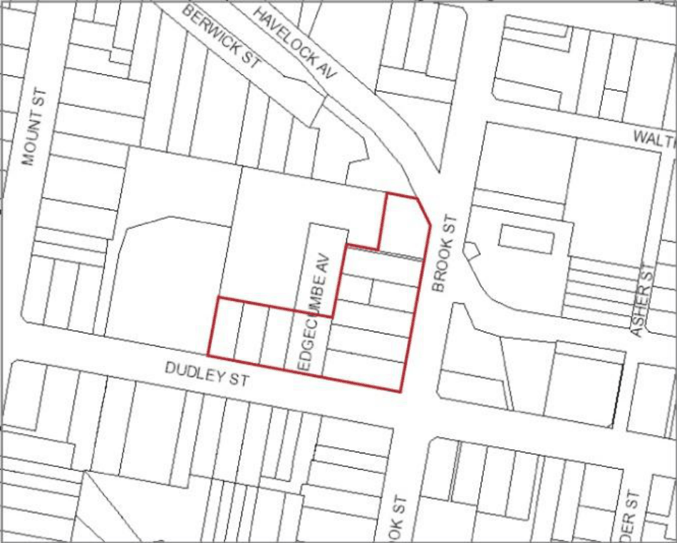

### 4.21. Edgecumbe Estate Heritage Conservation Area

A largely intact grouping of exceptional quality Inter-War period residential accommodation which represents the rapid residential development of Coogee following the First World War. The Edgecumbe Estate Heritage Conservation Area is located on the north-western corner of the intersection of Brook Street and Dudley Street, from Havelock Avenue in the north through to Our Lady’s Nurses for The Poor (35 Dudley Street, Coogee) in the west.

> [Picture on page 74: a picture, saved as a picture (images/part-b2-heritage-page-74-8.gif, 150 dpi).]

#### 4.21.1. Character values

Development must retain and enhance the outcomes expressed in the statement of significance for the HCA and as summarised below.

a. Subdivision - Lots are consistent in depth and width as er their original subdivision pattern following sale of Edgecumbe Estate

b. Landscape and public domain elements - Streetscapes have strong landscape quality with mature plantings, some elevated frontages to Brook Street

c. Scale and Form - Combination of single storey detached dwellings and two to three storey residential flat buildings

d. Siting and Setbacks - Consistent setbacks along Dudley Street with varying but cohesive setbacks to Brook Street

e. Roofs - Traditional hipped and gabled roof forms for detached dwellings and duplex, flat roofs (with or without parapet) or gambrel roof for residential flat buildings

f. Materials - Face brick, smooth faced red or liver bricks often with stone footings and stone trim elements, painted brick or roughcast rendered walls

g. Detailing - Decorative brickwork detailing to principal facades. Timber shingles, decorative leadlight windows. Protect inlaid concrete footpath signage and encourage provision for street names embedded in footpaths

h. Carparking - Accessed from secondary frontages Edgecumbe Avenue with some later addition parking structures to dwellings on Dudley Street and Brook Street

i. Fences - Combination of original brick or stone boundary fences with some later infill along the eastern side of Edgecumbe Avenue.

#### 4.21.2. Guidelines for change

No further subdivision or consolidation of allotments within the proposed conservation area should occur. Setbacks from street boundaries, maintain existing front garden areas and street boundary fences must be retained. Potential development should be located to the rear of buildings; no new garages should be located between street boundary and building facades. Avenue tree plantings are to be maintain and enhanced.

Randwick City Council 30 Frances Street Randwick NSW 2031

1300 722 542 council@randwick.nsw.gov.au www.randwick.nsw.gov.au
