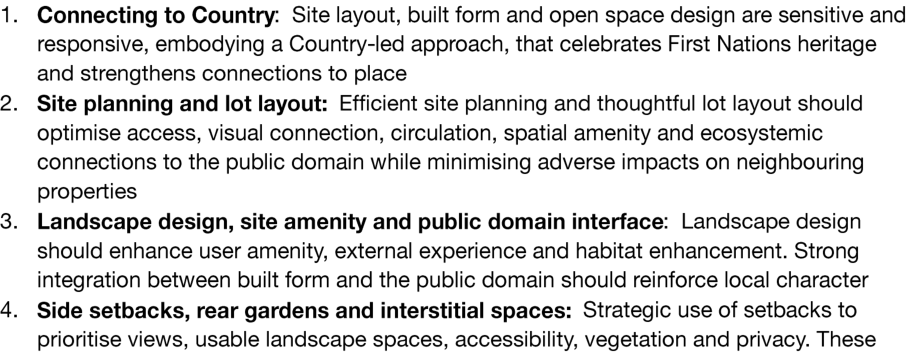
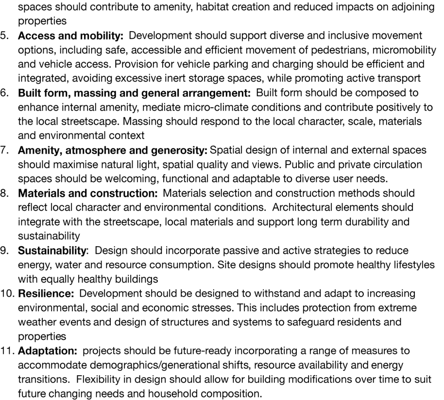

## 2. Design excellence

Explanation Design excellence is a guiding urban design principle that supports the creation of high-quality, vibrant and sustainable built environment. The Randwick Local Environmental Plan 2012 (RLEP 2012) includes overarching aims to promote ecological sustainability and resilience in the planning and development process. These aims reinforce the importance of design excellence as a mechanism to deliver built environments that are adaptable, resource-efficient, and responsive to environmental challenges. Clause 6.11 of the Randwick Local Environmental Plan 2012 (RLEP 2012) requires consideration of design excellence for:

• Buildings over 15 metres in height;

• Sites over 10,000 square metres in area; or

• Land where a site-specific Development Control Plan is required. In strategic locations, development proposals are encouraged to demonstrate a higher benchmark in architectural quality and sustainability. The RLEP 2012 outlines height and floor space ratio (FSR) controls for these centres. Where design excellence is demonstrated, as judged under an architectural design competition and the provision of social infrastructure, bonus height and FSR provisions may apply, along with potential exclusion of social infrastructure floor space from gross floor area calculations. Objectives

1\. Achieve outstanding architectural, urban and landscape design outcomes across Randwick City

2\. Enhance the character, aesthetic quality, functionality, and amenity of the public realm

3\. Encourage improved energy, water, and waste performance in new developments

4\. support the delivery of resilient and ecologically sustainable development outcomes aligned with the strategic aims of the RLEP.

Holistic site design provisions Development proposals should adopt a holistic and integrated approach to site design addressing the following key considerations:

> [Picture on page 7: a picture, saved as a picture (images/part-b3-sustainability-and-resilience-page-7-31.gif, 150 dpi).]
> Words printed on the picture (title and legend, copied from the PDF):
> 1\. Connecting to Country :  Site layout, built form and open space design are sensitive and
> responsive, embodying a Country - led approach, that celebrates First Nations heritage
> and strengthens connections to place
> 2\. Site planning and lot layout: Efficient site planning and thoughtful lot layout should
> optimise access, visual connection, circulation, spatial amenity and ecosystemic
> connections to the public domain while minimising adverse impacts on neighbouring
> properties
> 3\. Landscape design, site amenity and public domain interface :  Landscape design
> should enhance user amenity, external experience and habitat enhancement. Strong
> integration between built form and the public domain should reinforce local character
> 4\. Side setbacks, rear gardens and interstitial spaces: Strategic use of setbacks to
> prioritise views, usable landscape spaces, accessibility, vegetation and privacy. These

> [Picture on page 8: a picture, saved as a picture (images/part-b3-sustainability-and-resilience-page-8-1.gif, 150 dpi).]
> Words printed on the picture (title and legend, copied from the PDF):
> spaces should contribute to amenity, habitat creation and reduced impacts on adjoining
> properties
> 5\. Access and mobility: Development should support diverse and inclusive movement
> options, including safe, accessible and efficient movement of pedestrians, micromobility
> and vehicle access. Provision for vehicle parking and charging should be efficient and
> integrated, avoiding excessive inert storage spaces, while promoting active transport
> 6\. Built form, massing and general arrangement: Built form should be composed to
> enhance internal amenity, mediate micro - climate conditions and contribute positively to
> the local streetscape. Massing should respond to the local character, scale, materials
> and environmental context
> 7\. Amenity, atmosphere and generosity: Spatial design of internal and external spaces
> should maximise natural light, spatial quality and views. Public and private circulation
> spaces should be welcoming, functional and adaptable to diverse user needs.
> 8\. Materials and construction: Materials selection and construction methods should
> reflect local character and environmental conditions.  Architectural elements should
> integrate with the streetscape, local materials and support long term durability and
> sustainability
> 9\. Sustainability :  Design should incorporate passive and active strategies to reduce
> energy, water and resource consumption. Site designs should promote healthy lifestyles
> with equally healthy buildings
> 10\. Resilience: Development should be designed to withstand and adapt to increasing
> environmental, social and economic stresses. This includes protection from extreme
> weather events and design of structures and systems to safeguard residents and
> propertie s
> 11\. Adaptation: projects should be future - ready incorporating a range of measures to
> accommodate demographics/ generational shifts , resource availability and energy
> transitions.  Flexibility in design should allow for building modifications over time to suit
> future changing needs and household composition .

Note A checklist to assist with the implementation of these holistic site design principles has been provided in Appendix B. 40,000 litres or less or visitor accommodation.
