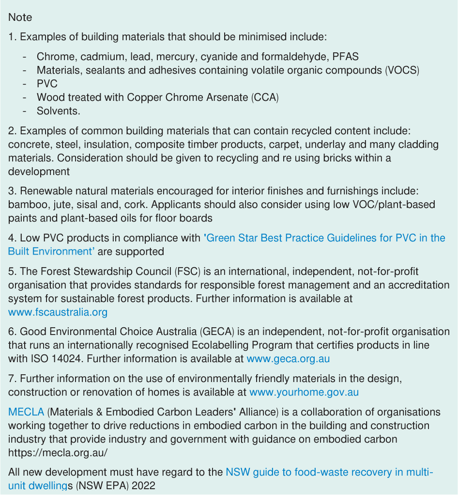

## 3. Building materials and finishes

Explanation The selection of materials for construction, renovation and/or refurbishment plays a critical role in shaping both environmental outcomes and/or the health and well-being of building occupants. Materials with high embodied carbon, poor durability, or harmful chemical content can negatively impact the environment and indoor air quality. A key principle underpinning sustainable material use is the circular economy, which aims to minimise waste and resource consumption by keeping materials in use for as long as possible. This involves designing for durability, reuse, repair, refurbishment, and recycling

—ultimately

reducing the environmental footprint of the built environment. Objectives The objectives for sustainable building materials and finishes are to:

1\. Promote the reduction, reuse, and recycling of building materials and components through the construction lifecycle

2\. Prioritise durable, low impact construction materials and finishes that are easy to maintain, repair or upgrade and are suitable to local environmental conditions

3\. Promote the use of sustainable, non-toxic materials that support healthy indoor environments, contain high recycled content and have low embodied carbon to minimise environmental impact and enhance occupant wellbeing

4\. Mitigate urban heat through passive design strategies and nature-based solutions that enhance thermal comfort year-round

5\. Facilitate end-of-life material recovery by selecting products that can be reused, repurposed or recycled, supporting a circular economy and favouring sustainably sourced timber, natural grass, permeable surfaces over high emission alternatives.

Controls

a) Prioritise the use low embodied carbon materials such as concrete with recycled content and minimise the use of high emission materials such as conventional steel and concrete by selecting lower emission alternatives including sustainably sourced timber, natural grass and permeable surfaces over steel, concrete, hard paving or synthetic grass

b) Development must specify light-coloured roofing materials to reduce building heat load/absorption and cooling energy demand in warmer months. Potential glare impacts on neighbouring properties must be assessed and appropriately mitigated

c) Development must incorporate cool paving materials, with high solar reflectance (SR) greater than 50% or use porous paving to support deep soil infiltration with near-surface water retention. A minimum of 50% of the site

’s hard landscaped surfaces

must apply one or a combination of these treatments

d) Design buildings to enable the adaptive re-use of existing building facades, structures and fittings where feasible, supporting circular economy principles and reducing construction waste

e) A schedule of materials must be submitted with the DA demonstrating the use of the following:

i. Durable, low maintenance materials

ii. Materials with low embodied energy content

iii. Products with high recycled content

iv. Locally sourced products and materials

v. Salvaged, recycled content or reused materials

vi. FSC-Certified timber from plantations or sustainably managed regrowth forests

vii. Low volatile organic compounds (VOC) paints, adhesives and floor covering

viii. Materials certified as sustainable or ‘environmentally friendly’ by a recognised third party certification scheme e.g. GECA

f) Development applications for non-residential projects proposing over 1,000 m² of additional gross floor area must include an embodied emissions assessment that details:

i. estimated quantities and associated emissions of key materials (e.g. concrete, structural steel, masonry, aluminium) based on the proposed design;

ii. measures to reduce embodied emissions through material selection and construction techniques; and

iii. strategies to minimise operational embodied emissions

across the building’s

lifecycle.

> [Picture on page 10: a picture, saved as a picture (images/part-b3-sustainability-and-resilience-page-10-17.gif, 150 dpi).]
> Words printed on the picture (title and legend, copied from the PDF):
> Built Environment’ are supported

Note

1\. Examples of building materials that should be minimised include:

- Chrome, cadmium, lead, mercury, cyanide and formaldehyde, PFAS

- Materials, sealants and adhesives containing volatile organic compounds (VOCS)

- PVC

- Wood treated with Copper Chrome Arsenate (CCA)

- Solvents.

2\. Examples of common building materials that can contain recycled content include: concrete, steel, insulation, composite timber products, carpet, underlay and many cladding materials. Consideration should be given to recycling and re using bricks within a development

3\. Renewable natural materials encouraged for interior finishes and furnishings include: bamboo, jute, sisal and, cork. Applicants should also consider using low VOC/plant-based paints and plant-based oils for floor boards

4\. Low PVC products in compliance with 'Green Star Best Practice Guidelines for PVC in the

5\. The Forest Stewardship Council (FSC) is an international, independent, not-for-profit organisation that provides standards for responsible forest management and an accreditation system for sustainable forest products. Further information is available at www.fscaustralia.org

6\. Good Environmental Choice Australia (GECA) is an independent, not-for-profit organisation that runs an internationally recognised Ecolabelling Program that certifies products in line with ISO 14024. Further information is available at www.geca.org.au

7\. Further information on the use of environmentally friendly materials in the design, construction or renovation of homes is available at www.yourhome.gov.au MECLA (Materials & Embodied Carbon Leaders' Alliance) is a collaboration of organisations working together to drive reductions in embodied carbon in the building and construction industry that provide industry and government with guidance on embodied carbon https://mecla.org.au/ All new development must have regard to the NSW guide to food-waste recovery in multi-unit dwellings (NSW EPA) 2022
