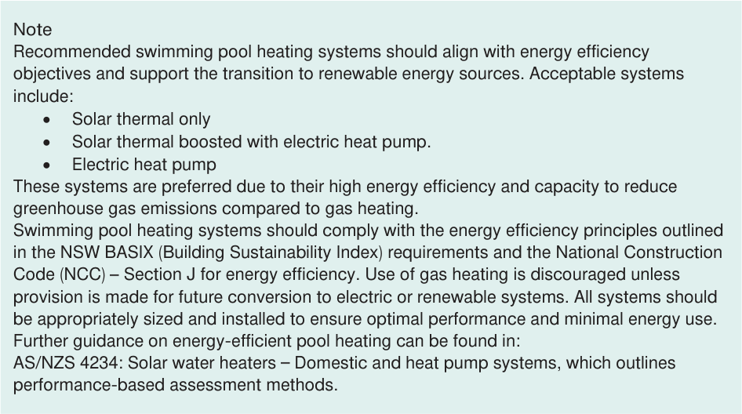

## 6. Energy efficiency and renewable energy

Explanation Buildings that are energy efficient offer substantial benefits including savings on the running costs of heating, cooling, lighting, and equipment, as well as reducing greenhouse gas emissions. In NSW energy and water efficiency measures for most residential development is regulated under the Sustainable Buildings State Environmental Planning Policy (SEPP) which requires a BASIX certificate (the Building Sustainability Index). The BASIX tool assesses proposed developments against location-specific targets for energy and potable water consumption. Developments that meet these targets are issued a BASIX certificate which must be submitted with a DA prior to assessment. For guidance on generating a BASIX certificate, refer to the BASIX tool. The controls in this Section apply to buildings not affected by BASIX. Minimum energy efficiency standards for buildings are also set out in Section J of the Building Code of Australia (BCA), which applies to non-residential and certain residential developments.

Note BASIX certificates required under the NSW Sustainable Buildings SEPP does not apply to residential alterations and additions valued < $50,000, swimming pools with a capacity of 40,000 litres or less or visitor accommodation.

Objectives The objectives for energy efficiency and renewable energy are to:

1\. Promote energy and water efficiency in the design, construction and operation of buildings

2\. Minimise greenhouse gas emissions across the lifecycle of development, including construction and ongoing use

3\. Reduce the reliance on mechanical heating and cooling by encouraging passive design

4\. Lower energy and water bills and reduce the whole of life cost of building energy services

5\. Encourage the use of renewable energy to power buildings and reduce peak energy demand

6\. Support development designed for low or zero carbon emissions, including buildings powered entirely by renewable energy.

Controls - All residential development Solar photovoltaic system and battery

a) The installation of photovoltaic panels with battery storage is strongly encouraged in all residential developments to support energy self-sufficiency and reduce grid reliance

b) New developments are to sign up to a minimum three-year 100% renewable power contract with an Australian Government endorsed energy provider and evidence of the future contract provided to Council at DA stage

> [Picture on page 15: a picture, saved as a picture (images/part-b3-sustainability-and-resilience-page-15-4.gif, 150 dpi).]
> Words printed on the picture (title and legend, copied from the PDF):
> • Solar thermal only
> • Solar thermal boosted with electric heat pump.
> • Electric heat pump

Note Recommended swimming pool heating systems should align with energy efficiency objectives and support the transition to renewable energy sources. Acceptable systems include:

These systems are preferred due to their high energy efficiency and capacity to reduce greenhouse gas emissions compared to gas heating. Swimming pool heating systems should comply with the energy efficiency principles outlined in the NSW BASIX (Building Sustainability Index) requirements and the National Construction Code (NCC)

– Section J for energy efficiency. Use of gas heating is discouraged unless

provision is made for future conversion to electric or renewable systems. All systems should be appropriately sized and installed to ensure optimal performance and minimal energy use. Further guidance on energy-efficient pool heating can be found in: AS/NZS 4234: Solar water heaters – Domestic and heat pump systems, which outlines performance-based assessment methods.

Cooking and space heating Objective

1\. To promote healthier indoor environments and reduce greenhouse gas emissions through the use of electric appliances.

Controls

a) Electrical appliances are encouraged for cooking and space heating in all new residential developments

b) Gas ovens and space heating systems should be avoided unless clear justification is provided demonstrating that the proposed gas appliance is the most energy-efficient option available at the time of development.

i. Gas vs Electric Appliance Comparison Table as provided in Appendix C must be completed and provided with the DA if gas ovens and/or space heating are proposed.

Note Why gas is discouraged in new developments Gas appliances such as cooktops, space heaters and hot water systems are increasingly discouraged in new developments due to their environmental, health and long-term economic impacts. Greenhouse gas emissions Natural gas is a fossil fuel that contributes significantly to carbon emissions during extraction, distribution and use. Transitioning to electric appliances powered by renewable energy supports climate goals and helps reduce the carbon footprint of buildings. Indoor air quality Gas cooking can release harmful pollutants such as nitrogen dioxide (NO), carbon monoxide (CO) and particulate matter. These pollutants can negatively affect indoor air quality and pose health risks, particularly in poorly ventilated or confined spaces. Future-proofing and cost efficiency Electric appliances, including induction cooktops and heat pump systems, are more energy-efficient and compatible with renewable energy sources. Avoiding gas infrastructure reduces the need for costly retrofits as the energy grid transitions to clean electricity.

Protection of solar infrastructure Objective

1\. To ensure continued solar access to photovoltaic energy systems and support renewable energy uptake. Controls

a) Development must be designed to minimise overshadowing of existing photovoltaic solar panels and solar hot water systems on adjacent or nearby properties

b) Shadow diagrams must be submitted for developments that may impact solar infrastructure, demonstrating compliance with this control

c) Shading from proposed buildings and structures must not reduce solar access to existing solar panels below 3 hours of direct sunlight between 9am and 3pm on the winter solstice

d) While canopy trees are generally exempt from solar access controls, applicants are encouraged to consider tree placement and species selection to avoid excessive shading of solar infrastructure.
