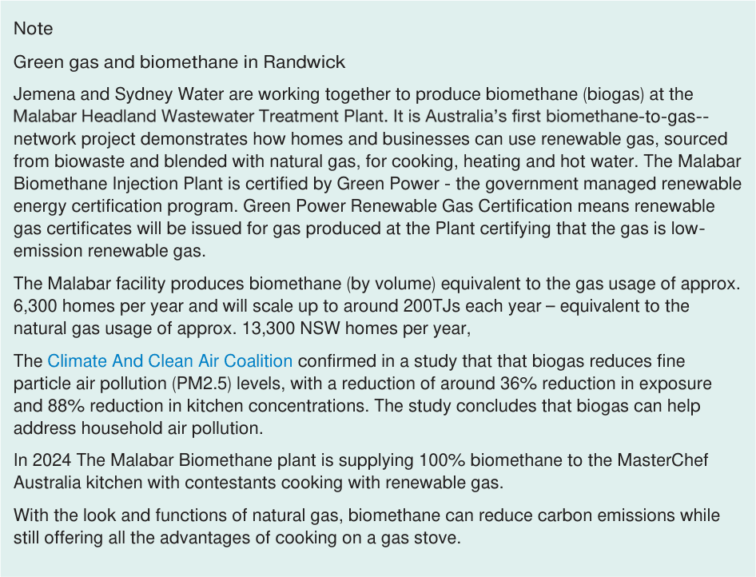

## 7. Design guidelines – Future proofing electric hot water systems

Objectives

1\. To ensure new dwellings are designed to allow easy retrofitting of electric hot water systems, supporting long term sustainability and energy transition.

Controls - Class 1 Buildings (Single dwellings)

a) Where gas instantaneous or gas storage domestic hot water system is proposed, the following provisions must be included to facilitate future installation of an electric hot water system:

i. A suitable location to place the future electric hot water system, compliant with relevant setback requirements in Part C1 Low Density Residential

ii. Installation of a dedicated electrical circuit and breaker for an electric hot water system rated at a minimum of 20 Amps for the future electric hot water system, located at the switchboard

iii. Provision of appropriate electrical cabling from the existing electrical switchboard to the designated location for the future electric hot water system.

Controls - Class 2 building (Multi-unit development)

a) If multiple gas instantaneous hot water systems or a centralised gas storage hot water system is proposed then the following inclusions shall also be provided, so that an electric hot water system can be easily retrofitted in the future:

i. A suitable location and sufficient space for the future electric hot water system(s) to meet the hot water demand of the residents. This must meet all current Australian Standards for electrical and plumbing installation

ii. The existing capacity of the electrical switchboard can meet the electrical demand of the future hot water systems

iii. Appropriate electrical cabling is in situ from the existing electrical switchboard to the future electric hot water systems.

> [Picture on page 18: a picture, saved as a picture (images/part-b3-sustainability-and-resilience-page-18-1.gif, 150 dpi).]
> Words printed on the picture (title and legend, copied from the PDF):
> Malabar Headland Wastewater Treatment Plant. It is Australia’s first biomethane -to-gas--

Note Green gas and biomethane in Randwick Jemena and Sydney Water are working together to produce biomethane (biogas) at the

network project demonstrates how homes and businesses can use renewable gas, sourced from biowaste and blended with natural gas, for cooking, heating and hot water. The Malabar Biomethane Injection Plant is certified by Green Power - the government managed renewable energy certification program. Green Power Renewable Gas Certification means renewable gas certificates will be issued for gas produced at the Plant certifying that the gas is low-emission renewable gas. The Malabar facility produces biomethane (by volume) equivalent to the gas usage of approx. 6,300 homes per year and will scale up to around 200TJs each year – equivalent to the natural gas usage of approx. 13,300 NSW homes per year, The Climate And Clean Air Coalition confirmed in a study that that biogas reduces fine particle air pollution (PM2.5) levels, with a reduction of around 36% reduction in exposure and 88% reduction in kitchen concentrations. The study concludes that biogas can help address household air pollution. In 2024 The Malabar Biomethane plant is supplying 100% biomethane to the MasterChef Australia kitchen with contestants cooking with renewable gas. With the look and functions of natural gas, biomethane can reduce carbon emissions while still offering all the advantages of cooking on a gas stove.
