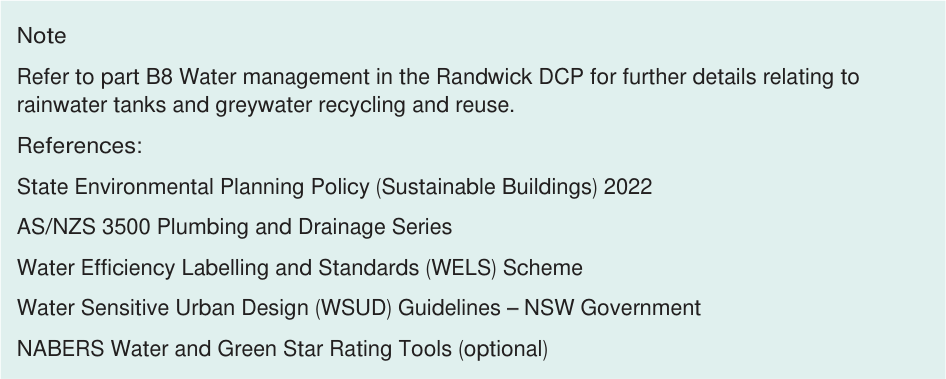

## 8. Water conservation

Council is committed to conserving water, enhancing water quality at our beaches, and strengthening water security in response to projected climate change impacts. Development must minimise reliance on potable water consumption while maximising use of non-potable water sources. Residential water conservation measures are mandated under the State Environmental Planning Policy (Sustainable Buildings) 2022. Objectives The objectives of water conservation are to:

1\. Promote the sustainable use of water across the City of Randwick

2\. Reduce reliance on mains-supplied potable water through conservation, reuse and alternative sources

3\. Support us of non-potable water systems, including rainwater, stormwater and greywater, where appropriate

4\. Improve long-term operational cost efficiency through reduced water consumption and increased system sustainability.

Controls

a) All developments must install water-efficient fixtures and fittings (e.g. WELS-rated taps, toilets, showers) in accordance with current Australian Standards

b) All developments must include rainwater tanks sized appropriately for site conditions and intended use (e.g. irrigation, toilet flushing, laundry)

c) Rainwater systems must be plumbed to non-potable uses where feasible

d) Stormwater reuse systems must be integrated where practical, particularly in large-scale or public/institutional developments

e) Greywater reuse systems are encouraged for large -scale developments particularly for irrigation and toilet flushing

f) Landscaping must be designed to minimise water demand, using drought-tolerant native species and efficient irrigation systems (e.g. drip irrigation, smart controllers)

g) All developments must incorporate Water Sensitive Urban Design (WSUD) principles to manage water sustainably, including permeable surfaces, swales, bio-retention systems, and green infrastructure

h) Water conservation systems must be maintained to ensure ongoing performance. Large developments may be required to submit a water management plan

i) For residential development:

i. Compliance with BASIX water targets is mandatory

ii. Dual plumbing for rainwater reuse is encouraged in multi-unit developments

j) For commercial/industrial development:

i. Cooling towers and process water systems must be designed for water efficiency and reuse

ii. Developments must demonstrate water conservation outcomes in sustainability assessments

k) For public/institutional development:

i. Public buildings are encouraged to include rainwater harvesting and WSUD features.

ii. Educational signage promoting water conservation should be included in public/institutional developments.

> [Picture on page 20: a picture, saved as a picture (images/part-b3-sustainability-and-resilience-page-20-1.gif, 150 dpi).]
> Words printed on the picture (title and legend, copied from the PDF):
> – NSW Government

Note Refer to part B8 Water management in the Randwick DCP for further details relating to rainwater tanks and greywater recycling and reuse. References: State Environmental Planning Policy (Sustainable Buildings) 2022 AS/NZS 3500 Plumbing and Drainage Series Water Efficiency Labelling and Standards (WELS) Scheme Water Sensitive Urban Design (WSUD) Guidelines NABERS Water and Green Star Rating Tools (optional)
