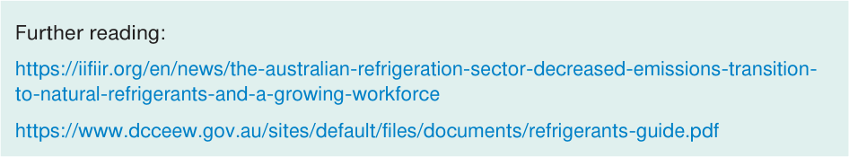

## 9. Natural refrigerants

Explanation Refrigerants are substances used in air conditioning, refrigeration, and heat pump hot water systems to absorb and release heat, enabling cooling or heating to occur. They are essential components of HVAC systems (Heating, Ventilation, and Air Conditioning), which are widely used across residential, commercial, and industrial developments. Natural refrigerants are compounds that occur naturally in the environment. Common examples include ammonia (NH₃), carbon dioxide (CO₂), and hydrocarbons such as propane (R-290) and isobutane (R-600a). These substances were widely used until the 1930s, when synthetic refrigerants, particularly fluorinated gases (F-gases), became more prevalent. Today, synthetic refrigerants known as Hydrofluorocarbons (HFCs) are commonly used in air conditioning systems, refrigerators, and hot water systems. However, leakage and improper disposal of these systems contribute significantly to global warming due to the high Global Warming Potential (GWP) of HFCs. In response, the Australian Government is phasing down bulk HFC imports under the Ozone Protection and Synthetic Greenhouse Gas Management Act 1989, in line with international commitments under the Montreal Protocol (see Refrigeration and air conditioning - Consumers - DCCEEW). In contrast, natural refrigerants have low or negligible GWP and are considered environmentally preferable. They are often more energy-efficient, cost-effective to produce, and readily available, making them a sustainable alternative to synthetic refrigerants. Their use can reduce operating costs, improve system performance, and support long-term climate goals.

Definition: Global Warming Potential (GWP) GWP is a measure of how much heat a greenhouse gas traps in the atmosphere over a specific time period, usually 100 years, compared to carbon dioxide (CO₂). Carbon dioxide has a GWP of 1, serving as the baseline. Gases with a higher GWP contribute more to global warming because they trap more heat. A GWP of 10 means the gas has ten times the impact of CO₂ in terms of contributing to global warming.

A comparison of the global warming potential of various natural and synthetic refrigerants is shown in Table 1 below:

Table 1:   Comparison of the global warming potential of various natural and synthetic refrigerants

| Refrigerant | Global Warming Potential |
|---|---|
| Ammonia (R717, NH3) commercial/industrial | 0 |
| Carbon dioxide (R744, CO2) | 1 |
| Hydrocarbons, e.g. propane (R290) or isobutane (R600a) | 3 |
| Hydrofluorocarbons R134a | 1430 |

Source : DCCEEW GWP Reference Table

Objectives: The objectives for refrigerant use in development are to:

1\. Minimise the use of refrigerants with high Global Warming Potential (GWP)

2\. Promote the adoption of low-impact, natural refrigerants (e.g. CO₂, ammonia, hydrocarbons)

3\. Ensure refrigerant systems are designed, installed, and maintained to reduce leakage and environmental harm

4\. Support pathways toward carbon neutrality and climate resilience across development types.

Controls:

a) All new developments must use refrigerants with a GWP of ≤150, unless technically unfeasible

b) Preference must be given to natural refrigerants (e.g. R-744, R-717, R-290) where safe and practical

c) Heating, Ventilation and Air Conditioning and refrigeration systems must meet or exceed minimum energy performance standards (e.g. NABERS or MEPS)

d) Refrigerant systems must be designed to minimise refrigerant charge and maximise efficiency

e) Leak detection mechanisms must be included in large-scale or high-risk systems (e.g. central HVAC, commercial refrigeration)

f) Smaller systems (e.g. residential split systems) must be maintained per manufacturer specifications and serviced by licensed technicians

g) All refrigerant systems must comply with maintenance standards under the Ozone Protection and Synthetic Greenhouse Gas Management Act 1989

h) Maintenance logs must be kept and made available for inspection

i) Refrigerant recovery and recycling must be undertaken during decommissioning

j) Disposal must comply with EPA and DCCEEW guidelines.

> [Picture on page 22: a picture, saved as a picture (images/part-b3-sustainability-and-resilience-page-22-28.gif, 150 dpi).]
> Words printed on the picture (title and legend, copied from the PDF):
> Further reading:
> https://iifiir.org/en/news/the-australian-refrigeration-sector-decreased-emissions-transition-
> to-natural-refrigerants-and-a-growing-workforce
> https://www.dcceew.gov.au/sites/default/files/documents/refrigerants-guide.pdf
