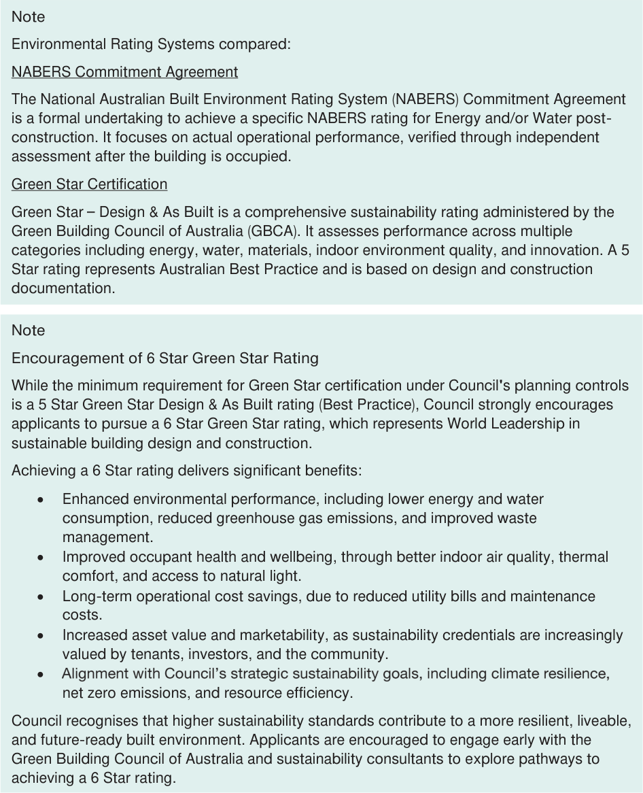

### 10.1. NABERS

Explanation This section establishes minimum environmental performance requirements for large-scale developments to ensure new buildings contribute to sustainable urban growth, resource efficiency, and climate resilience. It applies to developments with significant operational footprints, such as large commercial premises, hotels, and serviced apartments. NABERS (the National Australian Built Environment Rating System) is a nationally recognised rating tool which measures the environmental performance of buildings, focussing on energy and water consumption, indoor environment quality and waste impact.

Objectives

1\. Encourage the use of nationally recognised benchmarking tools to promote best practice environmental performance

2\. Promote energy and water efficiency in new developments

3\. Ensure buildings are designed and constructed to meet recognised sustainability standards

4\. Reduce greenhouse gas emissions and operational resource consumption

5\. Support the delivery of high-

performance buildings aligned with Council’s strategic

sustainability goals.

Controls

a) Applicability These controls apply to:

i. Offices, retail, industrial and health services facilities with a net lettable area of 1,000 square metres or more

ii. Hotels, serviced apartments, Co-Living and aged care with more than 100 rooms

b) Performance requirements Development applications must include documentation demonstrating that the proposed building will meet one of the following environmental performance standards:

i. NABERS Commitment Agreement Evidence that the building will enter into a NABERS Commitment Agreement for Energy and Water, in accordance with the schedule committing to 5.5-star energy and 4-star water as outlined in Table 2 below

ii. Green Star Certification Certification that the building will achieve a minimum 5 Star Green Star – Design & As Built (Best Practice) rating, as administered by the Green Building Council of Australia (www.gbca.org.au)

Table 2: Minimum NABERS Commitment Agreement Requirements

| Building Type | Energy NABERS commitment | Water NABERS commitment | NCC classification |
|---|---|---|---|
| Boarding House, hotels, Co-Living, Serviced apartments >50 rooms | 5.5 Star Energy | 4 star water | Class 3 Buildings |
| Office Buildings >1000sq GFA area | 5.5 Star Energy | 4 star water | Class 5 Buildings |
| Retail centres >1000sqm GFA area | 5.5 Star Energy | 4 star water | Class 6 Building |
| Industrial Warehouse/storage >1000sqm GFA | 5.5 Star Energy | 3 star water | Class 7 Building |
| Aged Care >50 rooms | 5.5 Star Energy | 4 star water | Class 9c Building |
| Health Services Facility > 1000sqm GFA | 5.5 Star Energy | 4 star water | Various depending on the type of facility (refer to NCC Classification) |

c) Timing of agreement NABERS Commitment Agreements must be entered into prior to the issue of any Construction Certificate for the approved development

d) Submission requirements NABERS Commitment documentation must be submitted via the NSW Planning Portal in accordance with Clause 79A of the Environmental Planning and Assessment Regulation

e) Heritage considerations Where the development involves a heritage item or is located within a heritage conservation area, and the performance standards in Table 2 cannot be achieved without unacceptable heritage impacts, variations may be considered if supported by:

i. A Heritage Impact Statement prepared by a suitably qualified heritage consultant

ii. Energy modelling prepared by a suitably qualified consultant

f) Exemptions A NABERS Energy Commitment Agreement may not be required where the consent authority is satisfied that compliance is not feasible due to site-specific constraints or heritage impacts, subject to appropriate supporting documentation

g) Verification and reporting A NABERS Commitment Agreement must be supported by a valid Commitment Agreement certificate and Section J Deemed-to-Comply Report (where applicable), submitted with the development application Post construction, the applicant must provide evidence of as-built NABERS or Green Star Certification prior to occupation certificate process.

> [Picture on page 26: a picture, saved as a picture (images/part-b3-sustainability-and-resilience-page-26-11.gif, 150 dpi).]

Note Environmental Rating Systems compared: NABERS Commitment Agreement The National Australian Built Environment Rating System (NABERS) Commitment Agreement is a formal undertaking to achieve a specific NABERS rating for Energy and/or Water post-construction. It focuses on actual operational performance, verified through independent assessment after the building is occupied. Green Star Certification Green Star

– Design & As Built is a comprehensive sustainability rating administered by the

Green Building Council of Australia (GBCA). It assesses performance across multiple categories including energy, water, materials, indoor environment quality, and innovation. A 5 Star rating represents Australian Best Practice and is based on design and construction documentation.

> Words printed on the picture (title and legend, copied from the PDF):
> • Enhanced environmental performance, including lower energy and water
> • Improved occupant health and wellbeing, through better indoor air quality, thermal
> • Long-term operational cost savings, due to reduced utility bills and maintenance
> • Increased asset value and marketability, as sustainability credentials are increasingly
> • Alignment with Council’s strategic sustainability goals, including climate resilience,

Note Encouragement of 6 Star Green Star Rating While the minimum requirement for Green Star certification under Council's planning controls is a 5 Star Green Star Design & As Built rating (Best Practice), Council strongly encourages applicants to pursue a 6 Star Green Star rating, which represents World Leadership in sustainable building design and construction. Achieving a 6 Star rating delivers significant benefits:

consumption, reduced greenhouse gas emissions, and improved waste management.

comfort, and access to natural light.

valued by tenants, investors, and the community.

net zero emissions, and resource efficiency.

Council recognises that higher sustainability standards contribute to a more resilient, liveable, and future-ready built environment. Applicants are encouraged to engage early with the Green Building Council of Australia and sustainability consultants to explore pathways to achieving a 6 Star rating.
