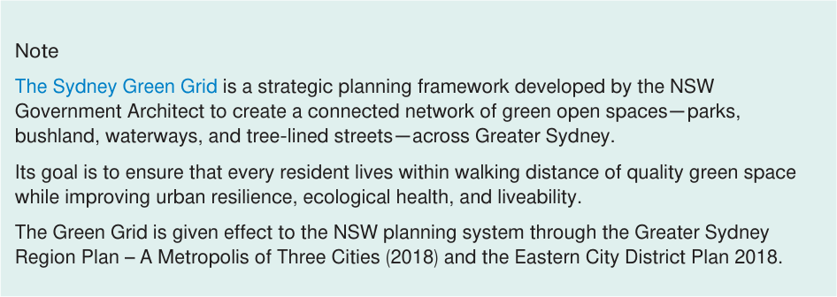

## 1. Introduction

Randwick City has a rich diversity of natural, cultural and scenic landscapes including significant areas of remnant bushland, wetlands and habitat corridors. These natural assets contribute to the City’s unique character and ecological significance. Landscaping plays an essential role in integrating development into the surrounding streetscape and neighbourhood. It enhances the visual amenity and usability of sites, supports recreation and leisure, preserves natural areas and contributes to improved stormwater management, environmental performance and micro-climatic conditions. Implementing the green grid, protecting areas of bushland and biodiversity, increasing tree canopy and increasing the native and indigenous species across the LGA are key priorities of the City of Randwick environment strategy 2022 and our Local strategic Planning statement 2023. A healthy urban forest provides significant aesthetic, ecological and environmental benefits to residents, workers and visitors to Randwick City. The long term protection and enhancement of Randwick’s urban environment - through the preservation and management of trees and vegetation is essential to achieving the goals set out in the Randwick Environment Strategy, including:

• Increasing native and indigenous plantings

• Expanding urban canopy cover

• Improving connectivity between bushland areas and habitat corridors This Part of the DCP outlines controls for preparing landscape plans and addressing landscape design matters, including controls for development in and near areas of biodiversity significance and habitat corridors. It aligns with State Environmental Planning Policy Biodiversity and Conservation 2021 (BC SEPP), which includes provisions for the protection and preservation of trees and vegetation. Vegetation clearing associated with development requiring consent will be assessed as part of the development assessment process and may also require additional assessment under the NSW Biodiversity Conservation Act 2016. This Part of the DCP applies to all development that impacts existing habitat or includes landscaping and governs the clearing of vegetation that falls below the Biodiversity Offset Scheme threshold outlined in the Biodiversity Conservation Act 2016. For the purposes of Part 2.3 of the BC SEPP, the following vegetation is declared to be vegetation to which the BC SEPP applies:

i. Any vegetation on l

Any vegetation on Land identified as ‘

and identified as ‘Biodiversity’ on the Terrestrial Biodiversity Map

in RLEP

ii. Any vegetation on land zoned Environmental Conservations C2 in the RLEP iii.

Biodiversity Habitat Corridor’ in SSROC

Connected Corridors for Biodiversity map.

This section of the DCP should be read in conjunction with:

• Part A - Introduction and other sections

• Part B5 - Preservation of Trees

Alignment with other planning instruments

In addition to the RLEP, the BC SEPP applies. In the event of an inconsistency between this DCP and the SEPP, the SEPP prevails to the extent of the inconsistency.

> [Picture on page 5: a picture, saved as a picture (images/part-b4-landscaping-and-biodiversity-page-5-5.gif, 150 dpi).]
> Words printed on the picture (title and legend, copied from the PDF):
> —parks,
> —across Greater Sydney.

Note The Sydney Green Grid is a strategic planning framework developed by the NSW Government Architect to create a connected network of green open spaces bushland, waterways, and tree-lined streets Its goal is to ensure that every resident lives within walking distance of quality green space while improving urban resilience, ecological health, and liveability. The Green Grid is given effect to the NSW planning system through the Greater Sydney Region Plan

– A Metropolis of Three Cities (2018) and the Eastern City District Plan 2018.
