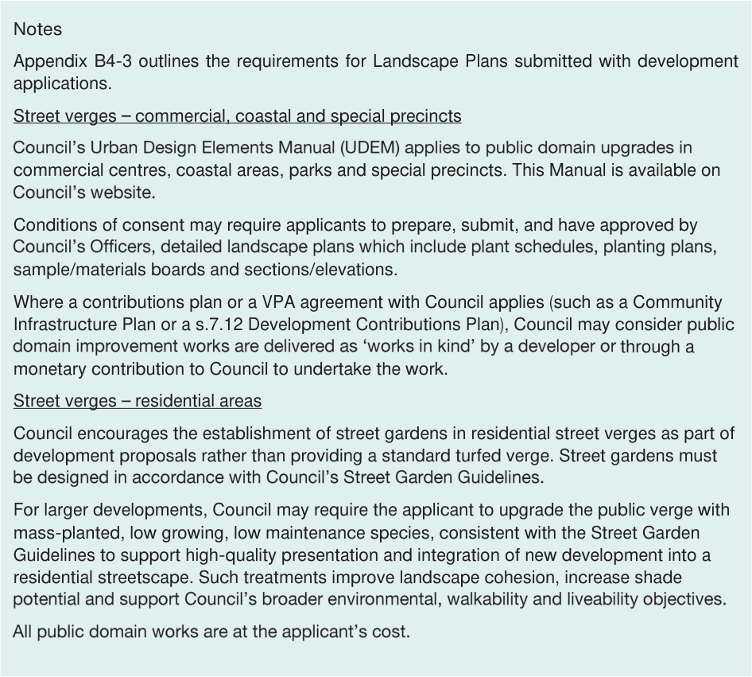

## 3. Landscape plan

Explanation A landscape plan is required to accompany all DAs for new buildings, and significant alterations or additions that may affect existing vegetation, tree coverage or landscaped areas on the site. This requirement ensures that:

• proposed developments contribute positively to the local environment and desired future character of the area

• Retains and protects significant vegetation

• supports urban biodiversity and ecological function

• Maintains and enhances the visual quality and environmental performance of the site and surrounding locality.

Landscape plans are to demonstrate how the development integrates with the surrounding landscape setting and responds to the site constraints and opportunities for preserving significant vegetation. Objectives

1\. Contribute positively to the desired future character of the area

2\. Soften the built form, improve streetscape presentation, and integrate new development with its surroundings

3\. Provide high quality private and communal open space that is functional, landscaped, and well-shaded

4\. Retain and enhance existing vegetation and landscape features

5\. Support urban canopy, biodiversity and climate resilience outcomes. Controls

a) A landscape plan submitted with a DA must be prepared in accordance with Appendix B4-3, including, but not limited to, the following elements and details:

i. Identification of all existing trees within or adjacent to the site including those on Council land. The plan must detail the location, height, condition and status of each tree (i.e. proposed to be removed/retained/relocated or pruned)

ii. Documentation of existing natural and built site features such as rocky outcrops, cliff lines, water bodies, sandstone retaining walls and any other significant landscape elements

iii. Delineation of hard and soft landscaped areas including deep soil zones and relationship of landscaped areas to buildings, accessways and open space areas

b) Location and selection of proposed plant species, including botanical and common names.  Selection of species appropriate to site conditions and local character, with preference for locally indigenous or climate-adapted species

c) Location of drainage infrastructure, including pits and stormwater lines, irrigation systems, hose taps, and lighting proposed within landscaped areas

d) measures to manage stormwater, irrigation, erosion and sedimentation during and after construction, consistent

with Council’s Construction Water Management requirements

as provided in Section 3.3 of Part B8 Water Management section of the DCP

e) Development consent must not be granted unless the consent authority is satisfied that the landscape design:

i. retains significant vegetation where feasible and minimises vegetation loss

ii. provides adequate deep soil areas and planting to support canopy growth

iii. integrates with the streetscape and surrounding landscape character

iv. will achieve a high-quality, sustainable landscape outcome over the long term.

> [Picture on page 10: a picture, saved as a picture (images/part-b4-landscaping-and-biodiversity-page-10-11.gif, 150 dpi).]
> Words printed on the picture (title and legend, copied from the PDF):
> Council’s Urban Design Elements Manual (UDEM) applies to public domain upgrades in
> Council’s website.
> Council’s Officers, detailed landscape plans which include plant schedules, planting plans,
> domain improvement works are delivered as ‘works in kind’ by a developer or through a
> – residential areas
> be designed in accordance with Council’s Street Garden Guidelines.
> potential and support Council’s broader environmental, walkability and liveability objectives.
> All public domain works are at the applicant’s cost.

Notes Appendix B4-3 outlines the requirements for Landscape Plans submitted with development applications. Street verges

– commercial, coastal and special precincts

commercial centres, coastal areas, parks and special precincts. This Manual is available on

Conditions of consent may require applicants to prepare, submit, and have approved by

sample/materials boards and sections/elevations. Where a contributions plan or a VPA agreement with Council applies (such as a Community Infrastructure Plan or a s.7.12 Development Contributions Plan), Council may consider public

monetary contribution to Council to undertake the work. Street verges Council encourages the establishment of street gardens in residential street verges as part of development proposals rather than providing a standard turfed verge. Street gardens must

For larger developments, Council may require the applicant to upgrade the public verge with mass-planted, low growing, low maintenance species, consistent with the Street Garden Guidelines to support high-quality presentation and integration of new development into a residential streetscape. Such treatments improve landscape cohesion, increase shade
