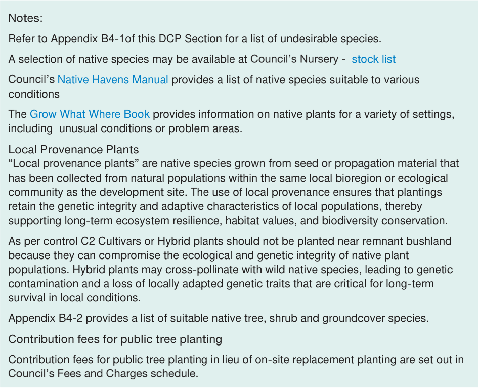

### 4.3. Selection and location of plant species

Explanation The appropriate selection and placement of plant species is essential to achieving high standards of landscape design, enhancing residential amenity, and supporting biodiversity conservation. Well-considered planting contributes to habitat creation, urban cooling, and the overall character of the development and surrounding area. Objectives

1\. Encourage the planting of appropriate native and locally indigenous plant species support and enhance habitat for fauna and flora

2\. Ensure plant species are suited to the

site’s aspect, soil conditions and microclimate

3\. Promote the use of local provenance/native species adapted to local conditions

4\. Enhance the appearance and amenity of development through high quality planting design, selection and placement

5\. Support Council’s urban tree canopy targets by maximising canopy tree planting across the LGA

6\.  Increase the diversity and resilience of locally indigenous plant communities across the LGA.

Controls

a) A minimum of 60% of all plant species within the landscape plan must comprise native species, including a mix of locally indigenous trees, shrubs and groundcovers selected from Appendix B4-2

b) For the purposes of this control:

i. Cultivars or hybrids of listed plant species are not counted towards the minimum native planting requirement; and

ii. The landscape plan must include a planting schedule that lists all proposed plant species, quantities and identifying species included in Appendix B42-1.

c) Invasive p

lant species, and any species listed in Council’s Undesirable Weed Species

List Appendix B4-1 must not be included in the landscape design

i. This control may be varied for heritage-listed properties or heritage conservation areas where it can be demonstrated that the species is required to maintain the historic or cultural landscape character of the site

d) Plant selection and layout must enhance and extend existing fauna and flora habitats and contribute to ecological connectivity across the site and surrounding locality. Species selection should utilise

Council’s Native planting List Appendix B4-2, where

appropriate

e) Where appropriate, development should incorporate food-growing areas (e.g. edible gardens, communal planting spaces) into the landscape design to support local sustainability and community wellbeing

f) Select and locate plants to improve environmental performance and site amenity. This includes:

i. Planting deciduous shade trees to regulate solar access —providing summer shade and allowing winter sunlight

ii. Using vegetation to reduce glare from hard surfaces

iii. Channelling air currents to improve natural ventilation

iv. Providing wind buffering where appropriate; and

v. Use of vegetation to screen noise, enhance privacy, and reduce visual impacts.

g) Trees must be located to allow for mature growth and to minimise conflict with built structures and services. As a minimum, trees must be planted no closer than 3.5 metres

to the external wall of a building and trees must be located at least two (2) metres from any proposed or existing drainage infrastructure

h) Where a tree proposed for removal under a Development Application is three (3) metres or more in height or has a canopy spread of three (3) metres or more, replacement planting must be provided on a site

i) Replacement trees must:

i. Achieve a mature canopy size equal to or greater than that of the tree to be removed

ii. Be specified and supported by a Landscape Plan and Arborist Report

iii. Be selected from Council’s Desirable Species List

iv. Be planted as advanced stock from a minimum 45L pot size to support successful establishment.

j) Where, in Council’s opinion, there is insufficient space on site to accommodate replacement trees of an appropriate size, the applicant may seek to contribute to offset planting on public land. Generally, for each tree removed, a minimum ratio of three (3) replacement trees for each tree removed is to be planted

in accordance with Council’s

policy

k) Development must provide at least one (1) canopy tree within the property boundary where practicable. Where it is demonstrated that this requirement cannot be achieved due to the site constraints, a compensatory planting contribution or bond must be provided to support tree planting within the local area, in accordance with Council policy.

> [Picture on page 14: a picture, saved as a picture (images/part-b4-landscaping-and-biodiversity-page-14-24.gif, 150 dpi).]
> Words printed on the picture (title and legend, copied from the PDF):
> Council’s Nursery -  stock list
> “Local provenance plants” are native species grown from seed or propagation material that
> Council’s Fees and Charges schedule.

Notes: Refer to Appendix B4-1of this DCP Section for a list of undesirable species. A selection of native species may be available at Council’s Native Havens Manual provides a list of native species suitable to various conditions The Grow What Where Book provides information on native plants for a variety of settings, including  unusual conditions or problem areas. Local Provenance Plants

has been collected from natural populations within the same local bioregion or ecological community as the development site. The use of local provenance ensures that plantings retain the genetic integrity and adaptive characteristics of local populations, thereby supporting long-term ecosystem resilience, habitat values, and biodiversity conservation. As per control C2 Cultivars or Hybrid plants should not be planted near remnant bushland because they can compromise the ecological and genetic integrity of native plant populations. Hybrid plants may cross-pollinate with wild native species, leading to genetic contamination and a loss of locally adapted genetic traits that are critical for long-term survival in local conditions. Appendix B4-2 provides a list of suitable native tree, shrub and groundcover species. Contribution fees for public tree planting Contribution fees for public tree planting in lieu of on-site replacement planting are set out in
