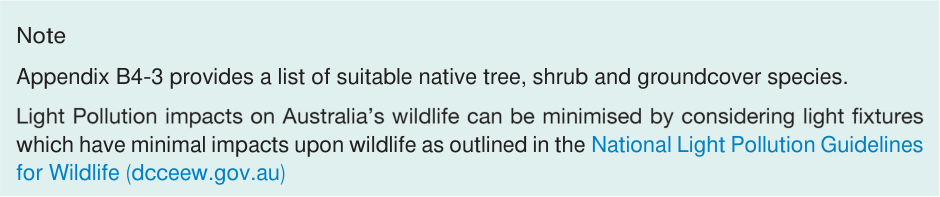

## 6. Development and biodiversity

### 6.1. Development in or near areas of high biodiversity significance

Explanation Areas of biodiversity significance in Randwick City are identified in the Terrestrial Biodiversity layer pursuant to the RLEP and are either zoned C2 Environment Conservation or identified in the SSROC connected corridors mapping. These identified sites are distributed across the City, including large areas of Eastern Suburbs Banksia Scrub (ESBS) and Acacia terminalis, listed as a critically endangered ecological community or species under the Biodiversity Conservation Act.

Table 3: Areas of High Biodiversity Value in Randwick

| Category | Subcategory | Mapping reference |
|---|---|---|
| Areas of High Biodiversity Value | Biodiversity Conservation Act protected areas Randwick LEP Terrestrial Biodiversity South Sydney Region of Councils (SSROC) connected Corridors for Biodiversity | Biodiversity Values Map LEP digital maps Digital map link |

Development within or adjacent to natural areas must be carefully planned and designed to avoid, minimise and mitigate impacts on biodiversity values at all stages of the development process Council recognises the significant ecological value of remnant native vegetation and bushland, as well as the important habitat and biodiversity functions provided by revegetated areas. These areas are highly sensitive to urban encroachment and associated pressures, including fragmentation, edge effects, and increased human activity. It is therefore essential that development responds appropriately to its context and incorporates measures to protect and enhance these natural assets, ensuring their long-term ecological integrity and resilience.

Note In NSW the Biodiversity Offset Scheme (BOS) applies to development proposals under Part 4 of the EP&A Act that involve the clearing of native vegetation. Local development will trigger the BOS if:

• the proposed development footprint intersects land mapped on the Biodiversity Values Map (typically shown a shaded purple colour) or

• The proposal exceeds the site area clearing threshold which varies depending on the minimum lot size associated with the site.

If either of these triggers is met the applicant must submit a Biodiversity Development Assessment Report (BDAR) with the Development Application.

The BDAR must

• Be prepared in accordance with the NSW Biodiversity Assessment Method (BAM) Be completed by a NSW accredited assessor formally certified to apply the BAM and prepare BDARs

Objectives The objectives for development in or near areas of high biodiversity value are to:

1\) Protect existing biodiversity and habitat features within and adjacent to development sites

2\) Ensure development in or adjacent to areas of biodiversity significance is designed, constructed and operated to appropriately manage the interface between the natural landscape and urban environment and protect the significant fauna and flora habitats

3\) Maintain and enhance ecological function and connectivity

4\) Protect and promote the recovery of threatened species, populations, and endangered ecological communities

5\) Ensure development has regard for direct and indirect impacts on biodiversity and natural areas

6\) Ensure landscape design elements are incorporated to provide a range of habitat features that can improve urban habitat

7\) Protect, regenerate and conserve the local threatened ecological communities

8\) Reduce the adverse impacts of light pollution on local fauna. Controls Development (including landscape works) within, or within 20m of areas of high biodiversity significance:

a) Must not impact on the environmental processes of natural areas, such as:

i. erosion of soils

ii. siltation of streams and waterways

iii. overland flows and stormwater runoff

iv. overshadowing

v. removal or degradation of existing vegetation.

b) Must consider and undertake appropriate protective measures during the design, construction and operation phases, such as:

i. adequate buffer areas between any building structures and the natural areas

ii. ongoing management arrangements to control invasive species and maintain natural features

iii. silt/protective fencing

iv. erosion and run off controls

v. appropriate site access points to prevent offsite disturbances

c) Landscape planting must prioritise native species with:

i. A minimum of 80% of the proposed trees

ii. 90% of the proposed shrubs

iii. 80% of the proposed grasses and groundcovers (not including turfed areas)

iv. to be endemic or native species suited to the local ecological context.

d) Plant species selection must demonstrate that proposed landscaping will:

i. not directly or indirectly adversely affect the ecological functioning of nearby remnant bushland areas, including through the introduction of invasive species, creation of monocultures, or disruption to local hydrology or light regimes (affect the local native gene pool)

ii. maintain the integrity of the local native gene pool, including through the use of locally appropriate species where practicable

iii. enhance ecological, cultural and visual values, including by contributing to habitat connectivity and strengthening links between bushland areas.

e) Trees containing hollows must be retained wherever possible to support habitat for arboreal fauna. Consideration must be given to the potential risk of damage to public or private property as determined by a suitably qualified arborist

f) Where retention of hollow-bearing trees is proposed, an assessment prepared by a suitably qualified arborist must:

i. confirm the health and structural stability of the tree

ii. identify and appropriately manage any risks to public safety or property.

g) Sites that are undeveloped should be protected and managed to encourage natural regeneration of native vegetation, including from the existing soil seed bank

h) External lighting on sites adjoining remnant vegetation must be designed and installed to minimise impacts on ecological values by:

i. directing light downwards and away from bushland, parks and reserves

ii. minimising light spill, glare and reflective surfaces into parks, reserves and bushland

iii. avoiding the short wavelength (blue-violet) light.

> [Picture on page 23: a picture, saved as a picture (images/part-b4-landscaping-and-biodiversity-page-23-13.gif, 150 dpi).]
> Words printed on the picture (title and legend, copied from the PDF):
> Light Pollution impacts on Australia’s wildlife can be minimised by considering light fixtures

Note Appendix B4-3 provides a list of suitable native tree, shrub and groundcover species.

which have minimal impacts upon wildlife as outlined in the National Light Pollution Guidelines for Wildlife (dcceew.gov.au)
