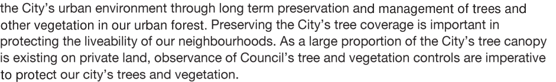

## 1. Introduction

A healthy urban forest provides significant aesthetic, ecological and environmental benefits to residents, workers and visitors of Randwick City. It is of vital importance to protect and enhance

> [Picture on page 4: a picture, saved as a picture (images/part-b5-preservation-of-trees-and-vegetation-page-4-4.gif, 150 dpi).]
> Words printed on the picture (title and legend, copied from the PDF):
> Preserving the City’s tree coverage is important in
> the City’s urban environment through long term preservation a nd management of trees and
> protecting the liveability of our neighbourhoods. As a large proportion of the City’s tree canopy
> is existing on private land, observance of Council’s tree and vegetation controls are imperative
> t our city’s trees and vegetation.

other vegetation in our urban forest.

to protec Implementing the Green Grid, protecting areas of bushland and biodiversity, increasing tree canopy cover and increasing the native and indigenous species across the LGA are key priorities of the City of Randwick Environmental Strategy 2022 and our Local Strategic Planning Statement 2036. This section applies to trees in Randwick City and supplements the State Environmental Planning Policy Biodiversity and Conservation 2021 (BC SEPP) by specifying additional types of tree works which require Council approval and guidance for preparation of applications seeking Council Tree permit approval.

This section of the DCP should be read in conjunction with:

• Part B4 Landscaping and Biodiversity of the DCP which covers trees on development sites.

Tree removal that is associated with building work requiring consent will be evaluated as part of the development assessment process and may also require additional assessment and approval under the NSW Biodiversity Act (2016). Please see Part B4

– Landscaping and Biodiversity. If

you wish to remove a tree or trees that have been conditioned to be retained or forms part of the approved landscape design in a development consent, you are required to apply for a section

4.55 or 4.56 amendment to your development consent.

Alignment with other planning instruments

In addition to the Randwick Local Environment Plan (LEP), the Biodiversity Conservation SEPP applies.

In the event of an inconsistency between this DCP and the SEPP, the SEPP prevails to the extent of the inconsistency.

Other Council documents This section of the DCP should be read in conjunction with the following tree management documents, which can be found on Council’s website:

• Tree Management Technical Manual

• Significant Tree Register

• Urban Forest Policy

• Sewerage Stormwater Drain Blockage Policy

• Street Tree Masterplan

• Street Tree Identification Manual

• Randwick City Council Local Environment Plan
