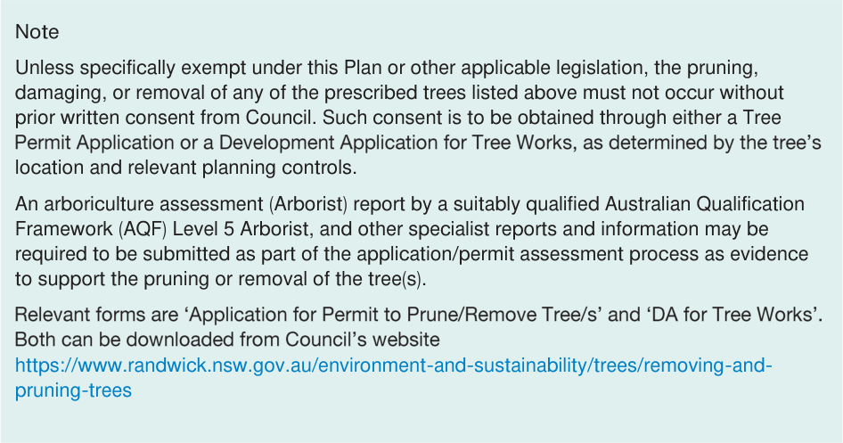

## 2. Tree Permits

Objectives The specific aims of this section are:

1\. To effectively protect and enhance the urban forest in Randwick City Council

2\. To protect and retain trees with cultural, heritage and natural significance

3\. To provide effective tree protection measures that promote the retention of vegetation and increase tree canopy coverage across the City of Randwick.

Controls

a) A tree permit is required to clear or carry out tree works to any of the following:

i. Any hollow bearing trees

ii. Severing of tree roots greater than 50 mm

iii. Tree with a height equal to or exceeding 5 metres

iv. Tree with a canopy width equal to or exceeding 4 metres

v. For a single trunk tree species, a trunk circumference equal to or exceeding 400 mm at a height of one (1) metre above ground level

vi. For a multi-trunk tree species, a combined trunk circumference (measured around the outer girth of the group of trunks) equal to or exceeding 400 mm at a height of one (1) metre above ground level.

> [Picture on page 5: a picture, saved as a picture (images/part-b5-preservation-of-trees-and-vegetation-page-5-19.gif, 150 dpi).]
> Words printed on the picture (title and legend, copied from the PDF):
> Permit Application or a Development Application for Tree Works, as determined by the tree’s
> Relevant forms are ‘Application for Permit to Prune/Remove Tree/s’ and ‘DA for Tree Works’.
> Both can be downloaded from Council’s website
> https://www.randwick.nsw.gov.au/environment-and-sustainability/trees/removing-and-
> pruning-trees

Note Unless specifically exempt under this Plan or other applicable legislation, the pruning, damaging, or removal of any of the prescribed trees listed above must not occur without prior written consent from Council. Such consent is to be obtained through either a Tree

location and relevant planning controls. An arboriculture assessment (Arborist) report by a suitably qualified Australian Qualification Framework (AQF) Level 5 Arborist, and other specialist reports and information may be required to be submitted as part of the application/permit assessment process as evidence to support the pruning or removal of the tree(s).
