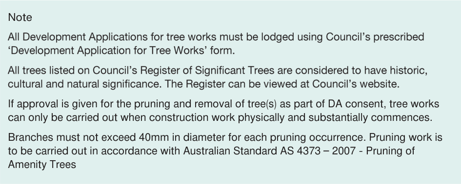

## 3. Development Applications for Tree Works

Objectives

1\. To ensure the protection and appropriate management of trees with heritage, cultural, or significant value by establishing clear requirements for Development Applications involving pruning or removal, thereby safeguarding the historic, cultural, and natural character of the area.

Controls

a) A Development Application (DA) for Tree Works is required to prune more than 10% of the live canopy within any 12-month period or to remove any tree that meets one or more of the following criteria:

i. The tree is located within a Heritage Conservation Area or forms part of a Heritage Item

ii. The tree is, or forms part of, an Aboriginal object or is within an Aboriginal place of heritage significance

iii. The tree is listed on Council’s Register of Significant Trees The proposed tree works will have an impact on heritage significance or amenity.

> [Picture on page 6: a picture, saved as a picture (images/part-b5-preservation-of-trees-and-vegetation-page-6-17.gif, 150 dpi).]
> Words printed on the picture (title and legend, copied from the PDF):
> Note
> All Development Applications for tree works must be lodged using Council’s prescribed
> ‘Development Application for Tree Works’ form.
> All trees listed on Council’s Register of Significant Trees are considered to have historic,
> cultural and natural significance. The Register can be viewed at Council’s website.

If approval is given for the pruning and removal of tree(s) as part of DA consent, tree works can only be carried out when construction work physically and substantially commences. Branches must not exceed 40mm in diameter for each pruning occurrence. Pruning work is to be carried out in accordance with Australian Standard AS 4373

– 2007 - Pruning of

Amenity Trees
