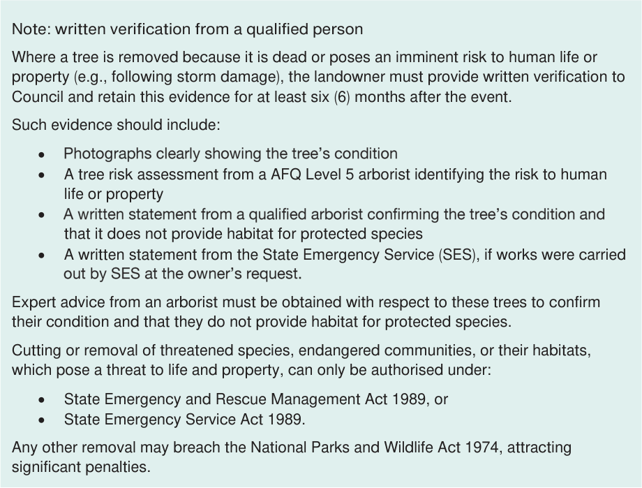

## 4. Exempt Vegetation

Objectives

1\. To clearly define circumstances where tree pruning or removal may occur without Council consent/permit, ensuring works are limited to essential maintenance, safety, and statutory obligations, and are carried out in accordance with recognised standards to protect environmental and heritage values.

Controls

a) Council consent is not required for tree works that meet all the following conditions:

i. All pruning must comply with AS 4373 –2007 Pruning of Amenity Trees

ii. Trees certified by Council or a qualified arborist as posing an imminent risk to life or property

iii. Emergency works undertaken under the State Emergency and Rescue Management Act 1989 or State Emergency Service Act 1989, with written verification (including photographs and an arborist’s report) provided to Council within 6 months

iv. Removal of trees confirmed as dead and not as the result of poisoning or vandalism or providing habitat for native fauna, with evidence retained

v. Removal of vegetation declared a priority weed under the Biosecurity Act 2015, except where located in a Heritage Conservation Area or are part of a heritage item, in which case Council must be notified at least 7 days prior (see Annexure B5-2 for a list of undesirable weed trees)

vi. Selective pruning of branches up to 40mm diameter within 2m of a building (work is in accordance with Australian Standard AS 4373

– 2007 - Pruning of Amenity

Trees)

vii. Crown thinning limited to 10% of live canopy within any 2 year period

viii. Removal of deadwood over 50mm diameter, roots under 50mm diameter, or branches up to 2.5m above ground level

ix. Formative pruning for young tree for powerline clearance in accordance with AS 4373

–2007 Pruning of Amenity Trees and relevant utility guidelines

x. Tree works to give effect to a development consent that permits the pruning or removal of the tree/s

xi. Any works authorised by or under the State Emergency and Rescue Management Act 1989 or State Emergency Service Act 1989 in relation to an emergency (within the meaning of that Act) and that was reasonably necessary to avoid an actual or imminent threat to life or property; and any emergency firefighting act or bush fire hazard reduction work within the meaning of the  Rural Fires Act 1997 that is authorised or required to be carried out under that Act.

b) The exemptions do not apply to:

i. Tree/s that are required to be retained by a condition of development consent

ii. Trees on public land owned or managed by Council

iii. Tree/s required to be planted as a condition of development consent or condition in a tree permit

iv. Threatened species or land containing native vegetation (including dead trees) that provides habitat for threatened species, populations, or ecological communities listed under Schedules 1 and 2 of the Biodiversity Conservation Act 2016, as well as other protected matters under the Environment Protection and Biodiversity Conservation Act 1999 (Commonwealth)

v. Land that is a declared area of outstanding biodiversity value under the Biodiversity Conservation Act 2016

vi. Land declared critical habitat under Part 7A of the Fisheries Management Act 1994

vii. Any native prescribed tree located as described in Section B4 areas of High Biodiversity Value

viii. Pruning more than 10% of the canopy, or proposed removal of a prescribed tree that is a heritage item, forms part of a Local heritage item, or is listed in the significant tree register, or located in a Local heritage conservation area or where the tree forms part of an Aboriginal object or is located within an Aboriginal place of heritage significance.

> [Picture on page 8: a picture, saved as a picture (images/part-b5-preservation-of-trees-and-vegetation-page-8-16.gif, 150 dpi).]
> Words printed on the picture (title and legend, copied from the PDF):
> • Photographs clearly showing the tree’s condition
> • A tree risk assessment from a AFQ Level 5 arborist identifying the risk to human
> life or property
> • A written statement from a qualified arborist confirming the tree’s condition and
> • A written statement from the State Emergency Service (SES), if works were carried
> out by SES at the owner’s request.
> • State Emergency and Rescue Management Act 1989, or
> • State Emergency Service Act 1989.

Note: written verification from a qualified person Where a tree is removed because it is dead or poses an imminent risk to human life or property (e.g., following storm damage), the landowner must provide written verification to Council and retain this evidence for at least six (6) months after the event. Such evidence should include:

that it does not provide habitat for protected species

Expert advice from an arborist must be obtained with respect to these trees to confirm their condition and that they do not provide habitat for protected species. Cutting or removal of threatened species, endangered communities, or their habitats, which pose a threat to life and property, can only be authorised under:

Any other removal may breach the National Parks and Wildlife Act 1974, attracting significant penalties.
