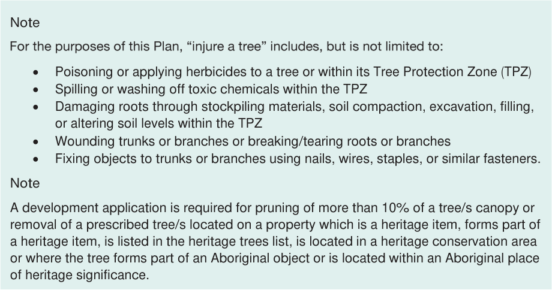

## 5. Penalties

Any clearing, pruning, or removal of vegetation without a Vegetation Clearing Permit, not in accordance with a development consent, or not exempt under this Plan or relevant legislation will be subject to enforcement action under applicable laws. These include the Local Government Act 1993 and the Environmental Planning and Assessment Act 1979. Local Government Act 1993 (Section 629) It is an offence to wilfully or negligently injure, damage, or unnecessarily disturb any tree or vegetation in a public place, including road reserves. Maximum penalty: 20 penalty units. Environmental Planning and Assessment Act 1979 (Division 9.6) Failure to obtain the required approval (development consent or tree permit, as applicable) constitutes an offence under Division 9.6. Offenders may be liable to: Failure to obtain the required approval, (that is, development consent or tree permit as applicable) is an offence under the Division 9.6 Criminal offences and proceedings under the Environmental Planning and Assessment Act 1979. This will render persons liable to significant penalties, issue of a Penalty Notice and/or the issue of an Order by Council. Offenders may also be required to rehabilitate the site, plant new trees and vegetation and maintain these until maturity.

> [Picture on page 9: a picture, saved as a picture (images/part-b5-preservation-of-trees-and-vegetation-page-9-18.gif, 150 dpi).]
> Words printed on the picture (title and legend, copied from the PDF):
> Note
> For the purposes of this Plan, “injure a tree” includes, but is not limited to:
> • Poisoning or applying herbicides to a tree or within its Tree Protection Zone (TPZ)
> • Spilling or washing off toxic chemicals within the TPZ
> • Damaging roots through stockpiling materials, soil compaction, excavation, filling,
> • Wounding trunks or branches or breaking/tearing roots or branches
> • Fixing objects to trunks or branches using nails, wires, staples, or similar fasteners.

or altering soil levels within the TPZ

Note A development application is required for pruning of more than 10% of a tree/s canopy or removal of a prescribed tree/s located on a property which is a heritage item, forms part of a heritage item, is listed in the heritage trees list, is located in a heritage conservation area or where the tree forms part of an Aboriginal object or is located within an Aboriginal place of heritage significance.
