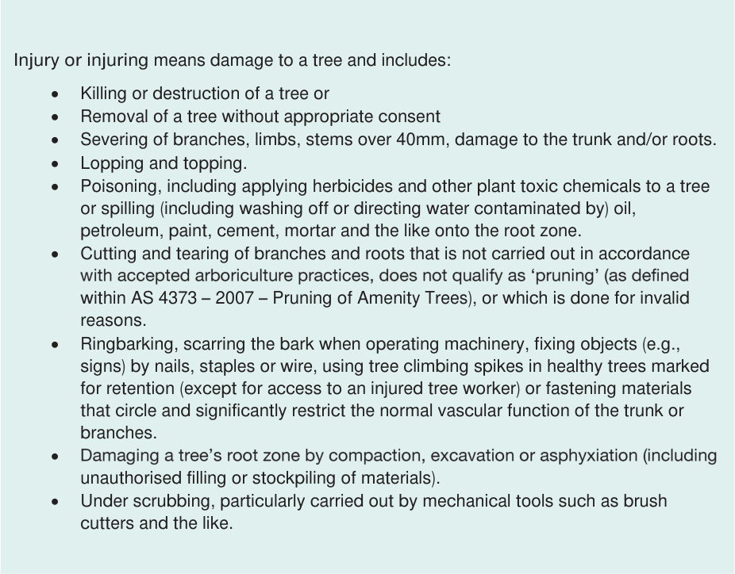

## 6. Effect of State Environmental Planning Policy (Exempt and Complying Development Codes)

The State Environmental Planning Policy (Exempt and Complying Development Codes) 2008 (Codes SEPP) contains provisions that affect tree and vegetation removal in relation to exempt and complying development. This section clarifies how these provisions apply within Randwick City. Objectives

1\. To ensure consistency between this DCP and the Codes SEPP regarding tree and vegetation removal

2\. To prevent unauthorised removal of prescribed trees during exempt or complying development

3\. To maintain heritage, environmental, and amenity values while facilitating lawful development.

Controls Exempt Development

a) Under Clause 1.16(1)(b) of the Codes SEPP, development cannot be considered exempt if it involves:

i. The removal or pruning of any tree or vegetation that requires consent under this DCP or other legislation, unless carried out in accordance with a valid permit or development consent.

Complying Development

a) Under Clause 3.1(2) and related provisions of the Codes SEPP:

i. A Complying Development Certificate (CDC) must not be issued if the proposal involves removal or pruning of a prescribed tree without Council approval

ii. Where tree removal is proposed, the applicant must provide:

• A Tree Permit or relevant Development Consent from Council; and

• Evidence that the tree is not listed on Council’s Register of Significant Trees .

iii. Tree works associated with complying development must comply with:

• AS 4373 –2007 Pruning of Amenity Trees; and

• Any conditions imposed by Council in the permit or consent.

b) All vegetation located on Council land shall be protected in accordance with the relevant sections within Council’s Tree Management Technical Manual. The tree protection measures shall be in place for the full duration of any work carried out through a CDC.

Distance and Size Restrictions

a) Vegetation less than 3m in height and located more than 3m from any building (other than an exempt structure) may be removed without consent, subject to compliance with this DCP and Codes SEPP

b) Trees within Heritage Conservation Areas, forming part of a Heritage Item, or listed on the Register of Significant Trees are not exempt under the Codes SEPP.

Heritage and Aboriginal Significance

a) Tree works affecting heritage significance or Aboriginal objects/places are not permitted as exempt or complying development under the Codes SEPP and require Council approval.

Note Private Certifiers must ensure compliance with these provisions before issuing a Complying Development Certificate (CDC). Failure to obtain required approvals may result in enforcement action under the Environmental Planning and Assessment Act 1979 and Local Government Act 1993.

Notes: State Environmental Planning Policy (Exempt and Complying Development Codes) 2008 If works are proposed under exempt development would involve cutting down or pruning a tree:

• You must first obtain tree removal approval from council unless the tree is exempt as specified in Section 4.1 Exempt Vegetation.

For complying development, the certifier cannot issue a CDC (Complying Development Certificate) if the works would require removal of a prescribed tree without council approval.

State Environmental Planning Policy (Exempt and Complying Development Codes) 2008 1.16: General requirements for exempt development:

(3) To be exempt development for the purposes of this Policy, the development must

—

(b) not involve the removal or pruning of a tree or other vegetation that requires a permit, approval or development consent, unless the removal or pruning is carried out in accordance with the permit, approval or development consent

### 1.18 General requirements for complying development:

(h)  for development involving the removal or pruning of a tree or other vegetation that requires a permit, approval or development consent —before the complying development certificate is issued, have the permit, approval or development consent.

3.33 Setbacks of dwelling houses attached development and detached development from protected trees:

(1) Pruning and removal of trees A complying development certificate for complying development under Division 1 is taken to satisfy any requirement under this Policy for a permit, approval or development consent to remove or prune a tree or other vegetation on the lot if —

(a)  the tree is not listed on a register of significant trees kept by the council, and

(b) the tree or vegetation will be within 3m of any building that has an area of more than 25m2, and

(c) the tree or vegetation has a height that is less than —

i. for development that is the erection of a dwelling house —8m and is not required to be retained as a condition of consent, or

ii. in any other case

—6m.

### Appendix A: Definitions

Dead tree means a tree with no living vascular tissue.

Destroy means any activity leading to the death, disfigurement or mutilation of a tree.

Height means the distance measured vertically between the horizontal plane of the lowest point of the base of the tree/s which is immediately above ground level and the horizontal plane of the uppermost point of the tree/s.

> [Picture on page 12: a picture, saved as a picture (images/part-b5-preservation-of-trees-and-vegetation-page-12-8.gif, 150 dpi).]
> Words printed on the picture (title and legend, copied from the PDF):
> • Killing or destruction of a tree or
> • Removal of a tree without appropriate consent
> • Severing of branches, limbs, stems over 40mm, damage to the trunk and/or roots.
> • Lopping and topping.
> • Poisoning, including applying herbicides and other plant toxic chemicals to a tree
> • Cutting and tearing of branches and roots that is not carried out in accordance
> with accepted arboriculture practices, does not qualify as ‘pruning’ (as defined
> within AS 4373
> – 2007
> reasons.
> • Ringbarking, scarring the bark when operating machinery, fixing objects (e.g.,
> • Damaging a tree’s root zone by compaction, excavation or asphyxiation (including
> • Under scrubbing, particularly carried out by mechanical tools such as brush
> cutters and the like.

Injury or injuring means damage to a tree and includes:

or spilling (including washing off or directing water contaminated by) oil, petroleum, paint, cement, mortar and the like onto the root zone.

– Pruning of Amenity Trees), or which is done for invalid

signs) by nails, staples or wire, using tree climbing spikes in healthy trees marked for retention (except for access to an injured tree worker) or fastening materials that circle and significantly restrict the normal vascular function of the trunk or branches.

unauthorised filling or stockpiling of materials).

Imminent risk includes but is not restricted to obvious instability of the root system, evidence of soil heave or cracking, loss of structural roots, root decay, storm damage and structural defects that are imminently hazardous, such as splitting branches. Evidence must be provided to Council in writing by photographic evidence or written evidence by a Qualified Arborist (AQF5).

Lopping means the cutting of branches or stems between branch unions or at internodes on trees.

Dead tree means a tree with no living vascular tissue.

Prune or pruning means cutting branches from a tree/s in a planned and systematic manner that is carried out in accordance with the provisions of AS 4373 - 2007 - Pruning of Amenity Trees, and which consists of the following pruning types:

• Crown maintenance pruning involving:

- general pruning

- thinning

- dead wooding

- selective pruning

- formative pruning

(Crown maintenance pruning relates to pruning according to the growth habit of the tree/s without reducing the area of the crown, while retaining the structure and size of the tree/s.)

• Crown modification pruning involving:

- reduction pruning

- crown lifting

- pollarding

- remedial pruning

- powerline clearance

(Crown modification pruning relates to pruning that changes the structural appearance and habit of the tree/s.)

Remove or removal means to cut down, fell, destroy, kill, take away, uproot or transplant a tree from its place of origin.

Topping means cutting away part or all of the tree canopy, leaving a trunk and stubbed main branches.

Tree works are works affecting the form, structure or foliage of a tree including root cutting, crown lifting, reduction pruning, selective pruning, crown thinning, remedial or restorative pruning or complete tree removal.

Trunk means the main stem of the tree, as distinguished from the branches and roots.

Undesirable species are plants listed in this control which are deemed undesirable due to characteristics which may lead to poisoning, weed infestation or bushland invasion.

Width means the distance measured horizontally (in metres) between the two (2) widest points of a tree’s canopy.

### Appendix B: Exempt Tree species List

| Botanical name | Common Name |
|---|---|
| Acacia saligna | Golden Wreath Wattle |
| Ailanthus altissima | Tree of Heaven |
| Alnus jorullensis | Evergreen Alder |
| Bambusa species | Bamboo species |
| Celtis occidentalis | Hackberry |
| Cinnamomum camphora | Camphor laurel |
| Cotoneaster species | Cotoneaster |
| Cupressocyparis x leylandii | Leyland Cypress |
| Erythrina species | Coral tree |
| Ficus elastica | Rubber tree |
| Lagunaria patersonia | Norfolk Island Hibiscus |
| Ligustrum lucidum | Large Leaf Privet |
| Nerium oleander | Oleander |
| Ochna serrulata | Ochna |
| Olea europea var. africana | African Olive |
| Populus species | Poplars |
| Salix species | Willows |
| Schefflera actinophylla | Umbrella tree |
| Syagrus romanzoffianum | Cocos Palm |
| Toxicodendron succedaneum | Rhus tree |

Note This table does not apply for Heritage Items or in Heritage Conservation Areas

Source Sydney Weeds network

Greater Sydney Regional Strategic Weed Management Plan

### Appendix C: Assessment criteria for tree works

The following matters are considered, but not limited to

a) Whether the tree has significant amenity or aesthetic value or is ecologically significant, with particular emphasis placed on retaining trees listed on Council’s Register of Significant Trees. The condition, maturity and Safe Useful Life Expectancy (SULE) of the tree/s

b) A report from a qualified arborist (AFQ 5 or higher), if required

c) Whether the tree is affected by the provisions of any other Act, Regulation or State Environmental Planning Policy applying to the land

d) The potential hazards to persons and/or property in the context of:

- the structural soundness of the particular tree (including condition of the canopy, amount of deadwood, any prolonged decline, significant and sustained insect attack, etc); and/or

- the characteristics and risk potential of the particular species; and/or

- siting issues such as ground conditions, building proximity, etc, which may give rise to a hazardous situation (particularly structural damage to public infrastructure and/or private property caused by the tree/s, its trunk or its root system); and/or

- ill health, such as allergies, where specific evidence is provided by an expert in the relevant medical field and a link between the ailment and the species is reasonably established; and/or

- existing (or potential for) traffic obstruction in relation to proximity to a roadway, intersection or driveway, where pruning would be an insufficient remedy

e) Whether the proposed work needs to be carried out by a suitably qualified and experienced person

f) Whether the tree is mapped within the ‘Biodiversity Habitat Corridor’

g) Whether appropriate additional (or replacement) planting has been or should be undertaken

h) The need for, and suitability of, soil erosion and siltation controls

i) Whether tree protection measures are required prior to works commencing

j) Whether a tree or vegetation is or provides habitat of a threatened species or ecological communities listed in Schedule 1 or 2 of the Biodiversity Conservation Act (BC Act) 2016

k) Whether, prior to the felling of a tree, special measures should be in place to reduce the potential for injury or death of animals likely to inhabit the tree. Such measures may include:

- inspection of hollows and other potential habitat sites on the tree

- sectional dismantling

- supervision of works by an arborist and/or a licensed wildlife carer or handler

l) The following should not generally be considered as valid reasons to remove a tree/s or native vegetation:

- leaf drop to gutters, downpipes, pools, lawns, etc.

- to increase natural light, where it is the sole consideration

- to improve street lighting into private property

- to enhance views or reduce the height of trees

- to reduce shade created by a tree/s

– particularly species such as Ficus or

Araucaria

- to reduce fruit, resin or bird droppings falling onto driveways and/or cars

- minor lifting of driveways, front fences, paths and footpaths by tree roots

- to erect a fence

- bushfire hazard control, which has not been verified by Council; or potential damage to sewer mains or stormwater pipes, unless supported by written expert advice and only where reasonable alternatives are not feasible (e.g. relocation or encasement of mains and replacement of damaged pipes in PVC plastic).

Randwick City Council 30 Frances Street Randwick NSW 2031

1300 722 542 council@randwick.nsw.gov.au www.randwick.nsw.gov.au
