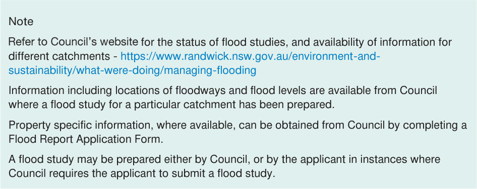

### 4.1. Flood studies and plans

Objectives

1\. To ensure that development addresses and is consistent with the requirements any relevant flood studies and FRMSP.

Controls

a) DAs are to identify all flood related information including flood levels, locations of floodways or overland flow paths impacting the site

b) Applications must comply with any catchment-specific controls in a Council adopted FRMSP in addition to the controls in this section. If there are any inconsistencies between an adopted FRMSP or this DCP, the controls of this DCP shall apply.

c) A site-specific Flood Risk Management Report or Flood Study may be required to demonstrate that there is no adverse impact on flooding of a site if an FRMSP or flood study for the catchment has not been prepared.

> [Picture on page 13: a picture, saved as a picture (images/part-b8-water-management-page-13-26.gif, 150 dpi).]
> Words printed on the picture (title and legend, copied from the PDF):
> Note
> Refer to Council’s website for the status of flood studies, and availability of information for

different catchments - https://www.randwick.nsw.gov.au/environment-and-sustainability/what-were-doing/managing-flooding Information including locations of floodways and flood levels are available from Council where a flood study for a particular catchment has been prepared. Property specific information, where available, can be obtained from Council by completing a Flood Report Application Form. A flood study may be prepared either by Council, or by the applicant in instances where Council requires the applicant to submit a flood study.
