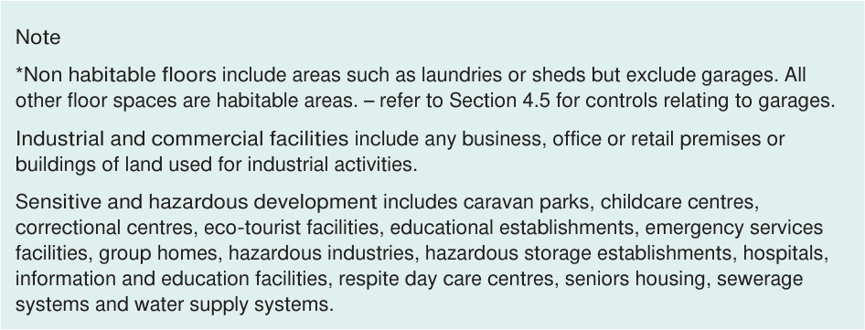

### 4.3. Flood levels

Explanation Floor levels refer to the minimum required building floor levels. For development such as basements, the floor level refers to the lowest level at each access point.

Objectives

1\. To ensure that floor levels are set at an appropriate height to reduce the frequency of inundation of structures and floors to an acceptable probability.

Controls

a) Building floor levels shall comply with Table 1 Floor levels for buildings, with the exceptions noted below

b) A single addition to the existing lowest habitable floor level may be permitted only after a flood study has been prepared. Such an addition will be limited to:

i. A maximum 10m2 for existing single and dual occupancy dwellings

ii. Up to 10% of the existing Gross Floor Area (GFA) for all other development (note for large buildings, this increase may be limited to a lower amount)

c) A certificate by a registered surveyor shall certify that the floor levels are not less than the required level

d) Where the lowest habitable floor area is elevated more than 1.5m above ground level, a restriction is to be placed on the title of the land confirming that the sub-floor area is not to be enclosed.

Table 1

– Floor levels for buildings

| Scenario | Floor level |
|---|---|
| Habitable floors – all development (excluding sensitive and hazardous development) |  |
| Inundated by flooding | 1% AEP + 0.5m freeboard |
| Inundated by overland flow path | Two times the depth of flow in the 1% AEP flood with a minimum of 0.3m above the surrounding surface |
| Habitable floors –sensitive and hazardous development |  |
| Inundated by flooding | PMF + 0.5m freeboard |
| Inundated by overland flow path | Two times the depth of flow in the PMF with a minimum of 0.3m above the surrounding surface (flood free land outside the overland flow path) |
| Non-habitable floors – residential outbuildings (excluding garages) * |  |
| Gross floor area less than or equal to 10 square metres | 1% AEP but not less than 0.15m above surrounding ground level |
| Gross floor area greater than 10 square meters | The applicable habitable floor level |
| Industrial and commercial |  |
| Located on flooding or overland flow path | 1% AEP but not less than 0.15m above surrounding ground level |
| Material storage locations – all development |  |
| Materials sensitive to flood damage, or which may cause pollution or be potentially hazardous during flooding | 1% AEP + 0.5m freeboard |

> [Picture on page 15: a picture, saved as a picture (images/part-b8-water-management-page-15-4.gif, 150 dpi).]

Note *Non habitable floors include areas such as laundries or sheds but exclude garages. All other floor spaces are habitable areas.

– refer to Section 4.5 for controls relating to garages.

Industrial and commercial facilities include any business, office or retail premises or buildings of land used for industrial activities. Sensitive and hazardous development includes caravan parks, childcare centres, correctional centres, eco-tourist facilities, educational establishments, emergency services facilities, group homes, hazardous industries, hazardous storage establishments, hospitals, information and education facilities, respite day care centres, seniors housing, sewerage systems and water supply systems.

Overland flow paths occur when:

• The maximum cross-sectional depth flowing through and upstream of the site is less than 0.25m for the 1% AEP flood for other than critical facilities, or 0.25 for the PMF for sensitive and hazardous development

• Existing surface levels within the site are above the floor level requirements, at the nearest downstream trapped low points

• The flood study demonstrates that blockage to any upstream trapped low point does not increase the depth of flow to greater 0.25m.

Note For more information on overland flow

paths, contact Council’s Development Engineering

section.
