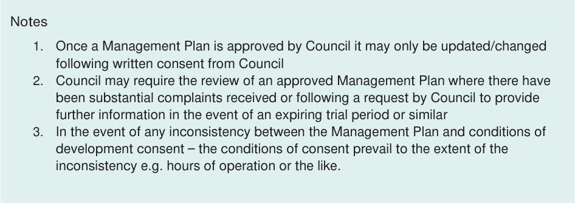

## 2. Management plan requirements

The Management Plan must address the following requirements: Objectives

1\. Objectives articulating the need for preparation of the Management Plan and outcomes it sets out to achieve

Site and context details

2\. Street address and lot number of the land to which the Management Plan applies

3\. Date of preparation

4\. Registered business name and trading name of the premises

5\. A description of the primary use of the premises as well as any secondary/ancillary uses. This may be in the form of a floor or site plan indicating the use of all areas within the building or site

6\. Types of activities within the premises including any variations at different times of the day, week or in different seasons

7\. Any ‘active areas’ adjacent to the boundaries of the site associated with the premises e.g. outdoor dining, queuing areas, etc where relevant

8\. A brief description of surrounding land uses including:

• Proximity to residential and other sensitive land uses (e.g. schools, places of worship, etc)

• Premises of a similar nature and scale

9\. Maximum capacity of the premises

10\. A schedule of proposed hours of operation for each day of the week for all areas of the premises

Operational details

11\. Name and contact details of operator/manager and type of management arrangement e.g. on site or managed through off site agent, etc.

12\. Organisational structure including number of staff, key roles and responsibilities. Information on any variation to staffing levels at different times of the day, week, or during different seasons should be provided

13\. The procedure for receiving, recording and handling complaints regarding the operation of the premises. A Complaints Register should be maintained on site which includes the following information:

• Complaint date and time

• Name, address and contact details of person making the complaint

• Nature of complaint

• Name of staff on duty

• Action undertaken by premises to resolve the complaint

• Follow up and outcome

14\. Details of training and induction procedures to ensure staff are aware of the provisions of the Management Plan and emergency procedures

15\. Any requirements in respect of the on-going management of the premises arising from any conditions placed on the Development Determination, if approved

Amenity

16\. Details on all measures to be undertaken to ensure that the operation of the premises will not adversely affect the amenity of the locality by way of noise, vibration, fumes, waste disposal and the like

Safety and security

17\. Details on systems and procedures to ensure the safety and wellbeing of staff, patrons/residents and/or other users of the premises including:

• Risk management procedures appropriate to the service provisions e.g. accident and injury, etc.

• Method of surveillance of common areas such as CCTV

• Location and monitoring of security alarms

• Security personnel and their duties

Waste management

18\. Procedures for minimising and managing waste and litter that is generated on site

19\. Details on how and when waste will be collected

20\. Details of when (frequency) and how the premises will be cleaned and serviced

21\. Location of waste storage areas Fire safety

22\. Details on proposed fire safety regime including:

• Annual certification (if required)

• Maintenance of emergency systems

• Actions to reduce fire risks

• Provision of an emergency evacuation plan

Deliveries and loading/unloading

23\. Details on deliveries including frequency, hours and type of vehicles associated with delivery and loading/unloading

24\. Guidelines for service providers and staff on how to mitigate any adverse impacts Declaration

25\. A signed declaration from the licensee/manager that they have read, understood and will ensure compliance with the approved Management Plan.

> [Picture on page 6: a picture, saved as a picture (images/part-b9-management-plan-page-6-27.gif, 150 dpi).]
> Words printed on the picture (title and legend, copied from the PDF):
> Notes

1\. Once a Management Plan is approved by Council it may only be updated/changed following written consent from Council

2\. Council may require the review of an approved Management Plan where there have been substantial complaints received or following a request by Council to provide further information in the event of an expiring trial period or similar

3\. In the event of any inconsistency between the Management Plan and conditions of development consent – the conditions of consent prevail to the extent of the inconsistency e.g. hours of operation or the like.

Randwick City Council 30 Frances Street Randwick NSW 2031

1300 722 542 council@randwick.nsw.gov.au www.randwick.nsw.gov.au
