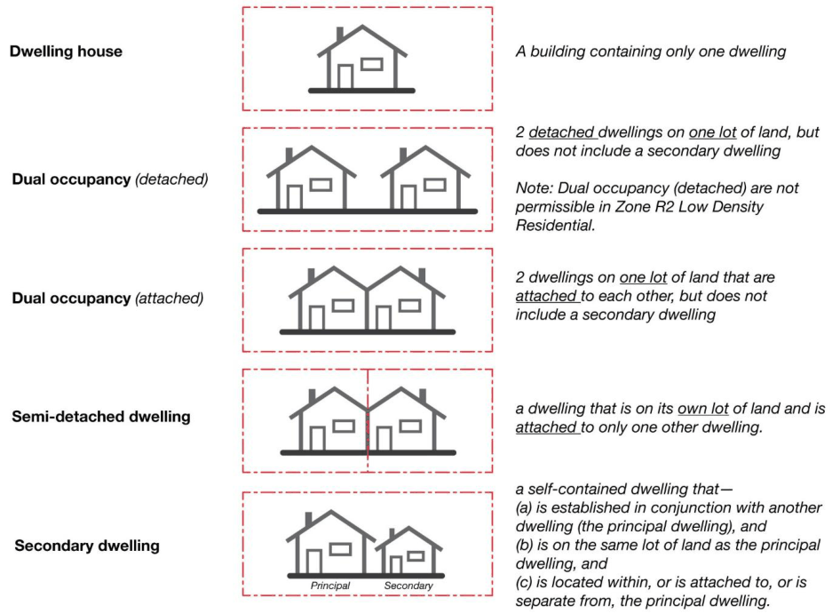

## 1. Introduction

Explanation This section applies to all new development and alterations and additions for low density forms of housing in the Randwick Local Government Area (LGA), being:

• Dwelling houses

• Dual occupancies (attached)

• Dual occupancies (detached)

• Semi-detached dwellings

• Secondary dwellings And ancillary facilities relating to the above dwelling types.

Figure 1: Types of low-density residential development

| Low-density residential development types |  |  |
|---|---|---|
| Type | Diagram | RLEP definition |

> [Picture on page 5: a picture, saved as a picture (images/part-c1-low-density-residential-page-5-13.gif, 150 dpi).]

Source: Randwick City Council 2023

Note Secondary dwellings are made permissible by State Environmental Planning Policy (Housing) 2021 (Housing SEPP) in all residential zones. The controls in this Development Control Plan (DCP) supplement the provisions of the Housing SEPP. Where there is any inconsistency between the provisions of this DCP and the SEPP, the SEPP shall prevail to the extent of that inconsistency.

This section of the DCP should be read in conjunction with:

• Part A

– Introduction

• Part B

– General Controls of the Development Control Plan (DCP); and

• Other Parts of the DCP for specific development types, locations or sites, if relevant to the application.
