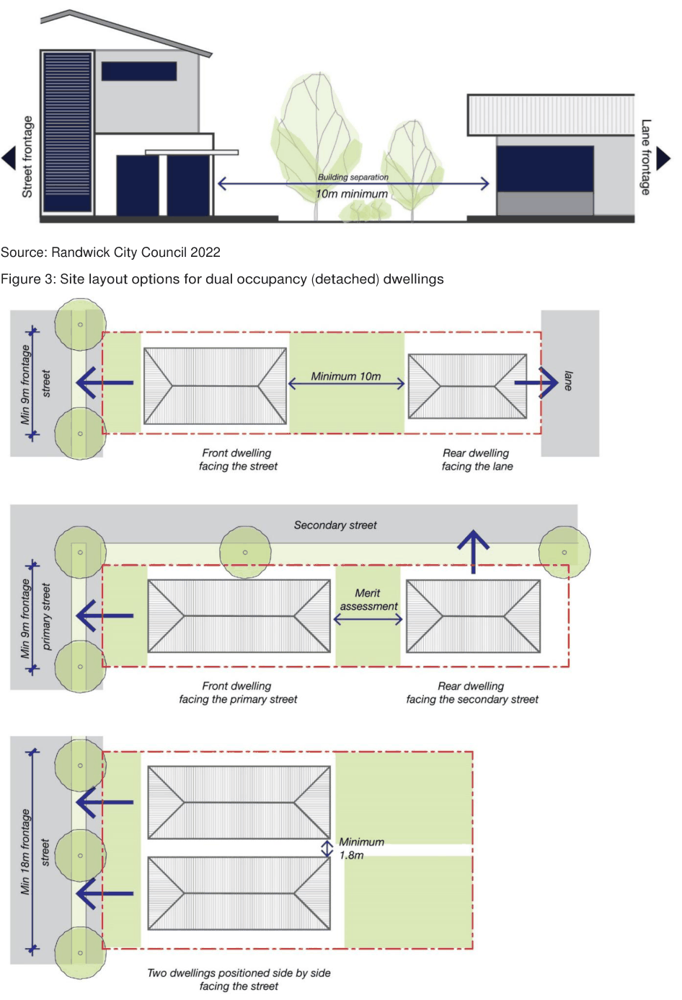

### 2.3. Dual occupancy (detached) site layout

Explanation Building layout plays an important role in ensuring adequate levels of amenity for the occupants of dual occupancy (detached) dwellings and adjoining properties, and to avoid adverse visual impacts on the streetscape. Ensuring appropriate building layout of dual occupancy (detached) that achieves adequate levels of privacy at the time of construction also is also a key consideration in the instance that future subdivision is sought. Objectives

1\. To ensure each dwelling in a dual occupancy (detached) development achieves adequate levels of living amenity in terms of private open space provision, solar access, privacy and accessibility.

Controls

a) The dwellings in a dual occupancy (detached) must be sited in the following manner:

i. One dwelling fronting the primary street and the other fronting the rear lane

ii. One dwelling fronting the primary street and the other fronting the secondary street

iii. Both dwellings fronting the primary street in a side-by-side arrangement for sites without rear lane or secondary street access

b) Pedestrian access of not less than 900mm in width must be provided to link any rear lane dwelling with the street frontage

c) Minimum building separation between the two dwellings in a dual occupancy (detached) must satisfy the following:

| Minimum Building Separation |  |  |
|---|---|---|
| Site characteristics | Building layout | Minimum building separation |
| Dual frontages with rear lane access | One dwelling fronting the street, with the other fronting the rear lane | 10m |
| Corner allotment | One dwelling fronting the primary street, with the other fronting the secondary street | Merit assessment |
| Single frontage | Both dwellings fronting the street in a side-by-side arrangement | 1.8m |

Definition Building separation is the distance between the nearest external walls of two buildings, excluding eaves, gutters, unroofed terraces, decks or landings not more than 1m above ground level (finished), and minor projecting features, such as awnings, sun hoods, screening devices and the like.

Figure 2: Building separation diagram for dual frontages with rear lane access

> [Picture on page 11: a picture, saved as a picture (images/part-c1-low-density-residential-page-11-2.gif, 150 dpi).]

Source: Randwick City Council 2022

Figure 3: Site layout options for dual occupancy (detached) dwellings

Source: Randwick City Council 2022
