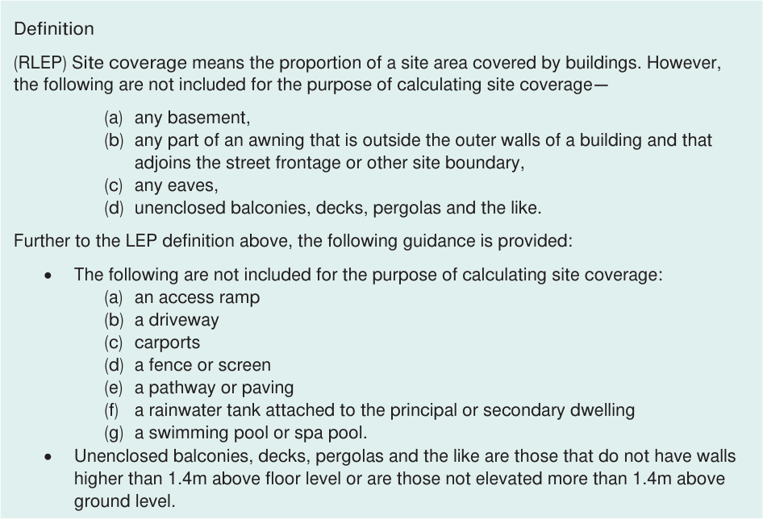
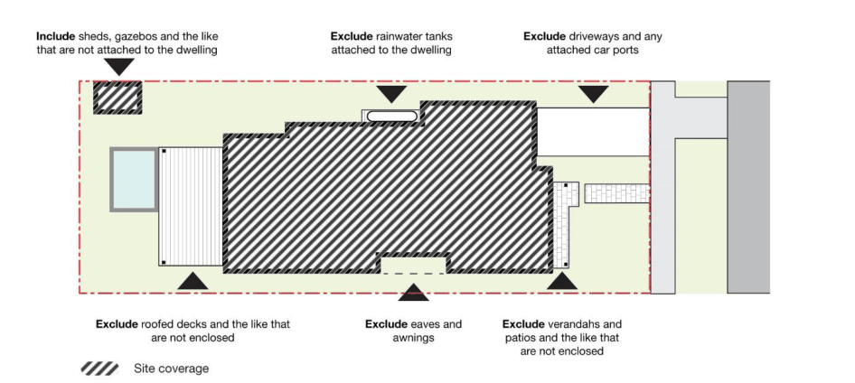

### 2.4. Site coverage

Explanation The site coverage control, in conjunction with setback controls, determines the extent and location within the property that a building may be constructed. The control ensures that there is sufficient unbuilt upon areas on a property to accommodate private open space, deep soil planting, permeable surfaces, recreational area and for services. Site coverage is expressed as a percentage to describe the proportion of a site that could be built upon. The allowable site coverage percentage decreases as allotment size increases, so that the mass and scale of any building will not detract from the character of the street.

> [Picture on page 12: a picture, saved as a picture (images/part-c1-low-density-residential-page-12-10.gif, 150 dpi).]
> Words printed on the picture (title and legend, copied from the PDF):
> • The following are not included for the purpose of calculating site coverage:
> • Unenclosed balconies, decks, pergolas and the like are those that do not have walls

Definition (RLEP) Site coverage means the proportion of a site area covered by buildings. However, the following are not included for the purpose of calculating site coverage —

(a) any basement,

(b) any part of an awning that is outside the outer walls of a building and that adjoins the street frontage or other site boundary,

(c) any eaves,

(d) unenclosed balconies, decks, pergolas and the like.

Further to the LEP definition above, the following guidance is provided:

(a) an access ramp

(b) a driveway

(c) carports

(d) a fence or screen

(e) a pathway or paving

(f) a rainwater tank attached to the principal or secondary dwelling

(g) a swimming pool or spa pool.

higher than 1.4m above floor level or are those not elevated more than 1.4m above ground level.

Objectives

1\. To ensure new development and alterations and additions to existing dwellings reserve adequate unbuilt upon areas for the purpose of private open space, deep soil planting, permeable surfaces and ancillary development

2\. To ensure a high level of environmental amenity for residents of low density dwellings in the LGA.

Controls

a) The maximum site coverage of a building must not exceed the following based on site area:

| Site area | Maximum Site Coverage- (% of site area) |
|---|---|
| Up to 300 sqm | 60% |
| 301 to 450 sqm | 55% |
| 451 to 600 sqm | 50% |
| 601 sqm or above | 45% |

Figure 4: Calculating site coverage

> [Picture on page 13: a picture, saved as a picture (images/part-c1-low-density-residential-page-13-2.gif, 150 dpi).]

Source: Randwick City Council, 2025

Notes Site area is measured according to the RLEP definition, being the area of any land on which development is, or is to be carried out. It is not measured against any proposed allotments / subdivision, Development applications must be supported by a site coverage calculation and deep soil permeable surface diagram see Figure 7 for an example.
