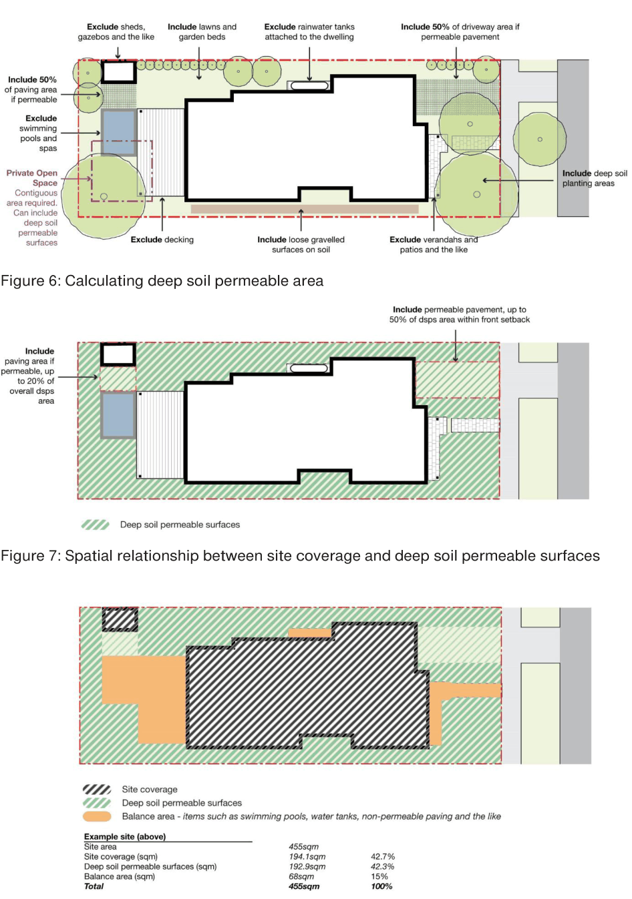

### 2.5. Deep soil permeable surfaces

Explanation Deep soil planting moderates local climatic conditions and enhances permeability of surface water and infiltration of stormwater, thus improving the environmental performance of development. It also provides areas for vegetation, tree planting and shade, and plays a screening function that improves mutual privacy and visual amenity between a development and its neighbours.

Definition Deep soil permeable surfaces include areas used for the growing of plants (including grasses, shrubs and trees) and areas occupied by loose gravels upon soil at the ground level of the site. However, the following are not included for the purpose of calculating deep soil permeable surfaces:

a) swimming and spa pools

b) paved areas including step ping stone pavers

c) artificial turf

d) planter boxes, or planted areas above basements, podiums, roofs, or slabs.

Objectives

1\. To retain and provide planting area for canopy trees and general vegetation to contribute to the overall tree canopy cover of the LGA and to the establishment of landscaped corridors across the locality

2\. To assist with stormwater infiltration and reduction of overland flow

3\. To improve climate resilience of the site. Controls

a) New development, or alterations and additions that change the existing site coverage by more than 10%, must provide the minimum area of deep soil permeable surfaces as specified in the table below:

| Site area Up to 300 sqm | Minimum Deep Soil Permeable Surfaces (% of site area) 30% |
|---|---|
| 301 to 450 sqm | 35% |
| 451 to 600 sqm | 40% |
| 601 sqm or above | 45% |

b) Where new development, or alterations and additions do not change the existing site coverage by more than 10%, there must be no net loss of deep soil permeable surfaces.

c) Deep soil permeable surfaces must have a width of not less than 900mm

d) Deep soil permeable surfaces should be located to support the retention of existing significant trees on site or those on adjoining sites

e) A minimum of 25% of the front setback area of a property must comprise deep soil permeable surfaces.

f) Permeable pavement and the like must not comprise more than 50% of deep soil permeable surfaces of the front setback area and no more than 20% of overall deep soil permeable surfaces required.

Dual occupancies and semi-detached dwellings

g) For new development, deep soil permeable surfaces are calculated on the overall site area and must be evenly distributed between the pair of dwellings.

Note When calculating changes in site coverage for alterations and additions, these are to be calculated as a percentage, not as percentage points. For example, if a development application proposes increasing site coverage from 40 percent to 45 percent, this is a 12.5% increase in site coverage and would trigger requirements within this DCP for minimum areas of deep soil permeable surfaces (2.5) and canopy cover (2.6) to be achieved.

Figure 5: Types of deep soil permeable surfaces

> [Picture on page 15: a picture, saved as a picture (images/part-c1-low-density-residential-page-15-2.gif, 150 dpi).]

Figure 6: Calculating deep soil permeable area

Figure 7: Spatial relationship between site coverage and deep soil permeable surfaces

Source: Randwick City Council, 2025
