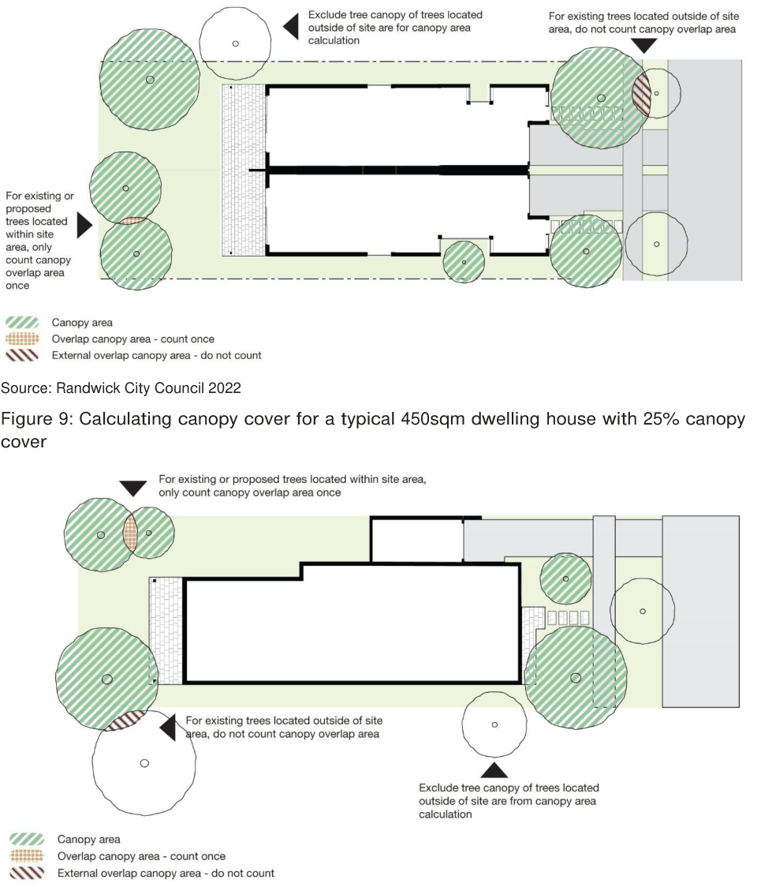

### 2.6. Landscaping and tree canopy cover

Explanation Landscaping assists in visually integrating development with the streetscape and the wider neighbourhood and provides an attractive and useable outdoor environment for residents. Tree canopy cover in urban areas provides numerous benefits including reduced building energy use, air pollution removal and carbon sequestration. In addition, areas with higher tree canopy cover provide increased amenity through shading, softening of built form and habitat for wildlife.

Objectives

1\. To ensure landscaped areas are effectively distributed on the site to achieve a visual balance between building structures and open space

2\. To provide privacy screening between dwellings

3\. To retain and provide for canopy trees and large shrubs to contribute to the overall tree canopy cover of the locality

4\. To encourage urban greening that contributes positively to the existing and desired future character of the locality

5\. To establish vegetation corridors across the locality

6\. To reduce the impacts of urban heat island effect.

Controls

a) New ancillary development, or alterations and additions that changes the existing site coverage by more than 10%, must demonstrate that a minimum of 25% canopy coverage as a proportion of the site area can be achieved within 10 years from the completion of development based on maturity of trees selected

b) In the circumstances where the consent authority is satisfied that there are sufficient environmental constraints on a site (such as significant slope) to limit the ability to achieve a 25% tree canopy cover on a site, a street tree planting fee may be considered to enable Council to plant trees in the public domain

c) To achieve the minimum canopy coverage requirement, the number of large canopy trees should be provided is in accordance with the table below:

| Site area Up to 300 sqm | Minimum number of large canopy trees 2 |
|---|---|
| 301 to 450 sqm | 3 |
| 451 to 600 sqm | 4 |
| 601 sqm or above | 4 |

d) Despite c), a combination of canopy tree sizes can be used to achieve the minimum tree canopy cover area

e) Canopy trees must achieve a minimum mature height of 5m. For allotments with constrained dimensions or site conditions, smaller trees with minimum mature height of 4m may be accepted by Council subject to achieving the minimum 25% canopy cover as per sub-clause b)

f) The trunk of canopy trees should be planted a minimum of 2.5m from any existing or proposed building

g) A minimum of 25% of the front setback area of a property must be landscaped with trees, shrubs and groundcover planting

h) Native species must comprise at least 60% of the plant schedule, incorporating a mix of locally indigenous trees, shrubs and groundcovers appropriate to the area and surrounds

i) Existing mature native trees on the site must be retained and incorporated in the landscape design whenever possible. Where a development involves removal of such existing trees, suitable replacement planting of equivalent or larger size must be provided

j) Suitable soil depth and volume must be provided on the site to support the healthy, sustained growth of trees

k) Proposed and existing retained trees must be protected by locating paved areas, underground services and rainwater tanks and building structures away from their root zones

l) Provide adequate sight lines for vehicles and pedestrians, especially near corners and intersections.

Dual occupancies and semi-detached dwellings

m) The minimum canopy coverage and number of canopy trees are calculated on the overall site area and must be evenly distributed between the pair of dwellings

n) For dual occupancies (attached) and semi-detached dwellings the front setback must contain at least one (1) tree per dwelling.

Notes Landscape requirements, plans and details are to be provided as per the requirements outlined in Section B4 of the RDCP. A street tree planting fee may be imposed on sites that cannot meet the tree canopy coverage targets outlined within this DCP due to site constraints. The funds accumulated from the street planting fee are utilised for street and public open space tree planting throughout the LGA. Tree species guidance and average mature dimensions for canopy calculations can be found in Council’s Street Tree Master Plan. It can be downloaded from the following link -https://www.randwick.nsw.gov.au/environment-and-sustainability/trees/preserving-our-trees An interactive version of the Precincts and Precinct Palette Species list contained within the Street Tree Master Plan can be accessed here - https://randwick-council.maps.arcgis.com/apps/webappviewer/index.html?id=5343844065dd44b0adc4d4ea5 37816d5 Native / indigenous plant species are required to be provided as they are better suited to the local soils and climate, they support native fauna (through providing food and habitat) and they require less water and are more drought tolerant. A tree is located within the site area if the majority of its trunk is located within the site area boundary. Street verges

– commercial, coastal and special precincts

Council’s Urban Design Elements Manual (UDEM) applies to public domain upgrades in commercial centres, coastal areas, parks and special precincts. This Manual is available on Council’s website. Conditions of consent may require applicants to prepare, submit, and have approved by Council’s Officers, detailed landscape plans which include plant schedules, planting plans, sample/materials boards and sections/elevations. Where a contributions plan or a VPA agreement with Council applies (such as a Community Infrastructure Plan or a s.7.12 Development Contributions Plan), Council may consider public domain improvement works are delivered as ‘works in kind’ by a developer or through a monetary contribution to Council to undertake the work. Street verges

– residential areas

Council encourages the establishment of street gardens in residential street verges as part of development proposals rather than providing a standard turfed verge. Street gardens must be designed in accordance with Council’s Street Garden Guidelines. For larger developments, Council may require the applicant to upgrade the public verge with mass-planted, low growing, low maintenance species, consistent with the Street Garden Guidelines to support high-quality presentation and integration of new development into a residential streetscape. Such treatments improve landscape cohesion, increase shade potential and support Council’s broader environmental, walkability and liveability objectives. Artificial or synthetic turf is not permitted within nature strips or street verges. Nature strips and verges must be landscaped using natural turf, groundcovers or planting that supports streetscape outcomes, urban cooling, stormwater infiltration, and the protection of public utility infrastructure. All public domain works are at the applicant’s cost.

Figure 8: Calculating canopy cover for a typical 550sqm dual occupancy (attached) or semi-detached dwelling with 25% canopy cover

> [Picture on page 19: a picture, saved as a picture (images/part-c1-low-density-residential-page-19-3.gif, 150 dpi).]

Source: Randwick City Council 2022 Figure 9: Calculating canopy cover for a typical 450sqm dwelling house with 25% canopy cover

Source: Randwick City Council 2022
