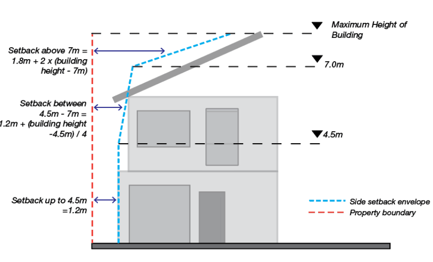

#### 3.3.2. Side setbacks

Controls

a) New buildings and alterations and additions must comply with the following minimum side setbacks based on the primary frontage width:

| Minimum side setbacks |  |  |  |
|---|---|---|---|
| Existing primary frontage width | Setback up to 4.5m from ground level (existing) | Setback between 4.5m to 7m from ground level (existing) | Setback above 7m from ground level (existing) |
| Less than 6m | Merit assessment |  |  |
| 6m to less than 9m | 0.9m | 0.9m | 0.9𝑚+ (𝑏𝑢𝑖𝑙𝑑𝑖𝑛𝑔 ℎ𝑒𝑖𝑔ℎ𝑡−7𝑚) |
| 9m to less than 12m | 0.9m | 𝑏𝑢𝑖𝑙𝑑𝑖𝑛𝑔 ℎ𝑒𝑖𝑔ℎ𝑡−4.5m 0.9𝑚+ 4 | 1.5𝑚+ 2 𝑥 (𝑏𝑢𝑖𝑙𝑑𝑖𝑛𝑔 ℎ𝑒𝑖𝑔ℎ𝑡−7𝑚) |
| 12m and above | 1.2m | 𝑏𝑢𝑖𝑙𝑑𝑖𝑛𝑔 ℎ𝑒𝑖𝑔ℎ𝑡−4.5𝑚 1.2𝑚+ 4 | 1.8𝑚+ 2 𝑥 (𝑏𝑢𝑖𝑙𝑑𝑖𝑛𝑔 ℎ𝑒𝑖𝑔ℎ𝑡−7𝑚) |

Figure 10: Application of side setback controls on a 12m wide existing primary frontage width lot

> [Picture on page 24: a picture, saved as a picture (images/part-c1-low-density-residential-page-24-4.gif, 150 dpi).]

Source: Randwick City Council 2025

b) Despite control a), side setbacks on sites with a significant slope may be subject to a merit assessment. In such cases, applicants must demonstrate that side setbacks:

i. Minimise visual bulk and avoid creating overbearing massing of development when viewed from neighbouring dwellings and the public domain

ii. Ensure adequate separation between neighbouring buildings for visual and acoustic privacy and solar access

iii. Maintains a consistent rhythm of setbacks that contributes to the low-density, one to two storey character of the neighbourhood

Note: Refer to Sub-Section 6. Car Parking and Access for further information relating to side setback requirements for parking facilities.
