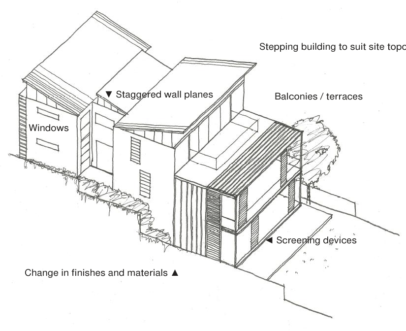

## 4. Building design

### 4.1. General

Explanation Following the establishment of the permissible building envelope (defined by site coverage, setbacks, FSR, Height of Building and external wall height), the form and mass of the development needs to be modelled to respond specifically to the site characteristics and the surrounding natural and built context. Façade treatment and detailing affect the visual presentation of buildings and play a pivotal role in enhancing the character and continuity of streetscapes. Façade composition has an impact on the perceivable bulk and scale of a building and should be carefully designed to achieve an appropriate streetscape outcome.

Objectives

1\. To ensure the form, scale, massing and proportions of dwellings recognise and adapt to the characteristics of a site in terms of topography, configuration, orientation and surrounding natural and built context

2\. To ensure building facades are articulated to complement or enhance the existing streetscape and neighbourhood character

3\. To ensure that internal rooms are well proportioned, functional and provide a high standard of amenity

4\. To encourage contemporary and innovative designs that contribute to neighbourhood character in new and transitional residential areas.

Controls a)

, avoid the creation of ‘wedding cake’ or

A dwelling’s overall built form must respect and follow the natural topography of the site. On sloping sites, the building mass must be modelled or stepped in response to the prevailing slope of the land and avoid concentrating the structural bulk on the uphill or downhill side of the allotment

b) When arranging the built form on the site ‘pyramid’ type buildings which due to their visual dominance are generally unsympathetic in their relationship to the natural landform

c) External facades of the dwelling must be articulated to reduce the apparent mass and to present a human scale to adjoining properties, public areas and from key vantage points. This must be achieved by at least two of the following design measures:

i. Window openings

ii. Balconies or terraces

iii. Entry porches

iv. Staggered wall planes

v. Varied materials and finishes

vi. Decorative architectural elements.

Figure 11: Design measures for modelling and articulating a building

> [Picture on page 27: a picture, saved as a picture (images/part-c1-low-density-residential-page-27-2.gif, 150 dpi).]
> Words printed on the picture (title and legend, copied from the PDF):
> Stepping building to suit site topography
> Balconies / terraces
> ▼ Staggered wall planes
> Windows
> ◄ Screening devices
> Change in finishes and materials ▲

Source: Randwick City Council

d) Divide side elevations into sections, bays or modules of not more than 12m length, separated by measures, such as recesses or side courtyards, in order to avoid massive or unrelieved walls

e) Articulation zones and recesses are to be a minimum of 0.5m in depth and 1m in width.

f) Articulate all street elevations for development on corner allotments

g) Alterations and additions to an existing dwelling must present an integrated design with suitable configuration, materials and detailing, so that the new and retained structures provide an integrated composition

Note For heritage items or buildings within Heritage Conservation Areas (HCA), it may be desirable to distinguish between old and new works. Refer to Section B2 Heritage of this DCP for further details.

h) Balconies, terraces and decks must be of a size and configuration that are appropriate to the proportions of the building without excessively increasing its visual bulk

i) Master bedrooms must have a minimum area of 10m2 and other bedrooms 9m2, both with a minimum dimension of 3m (excluding wardrobe space).
