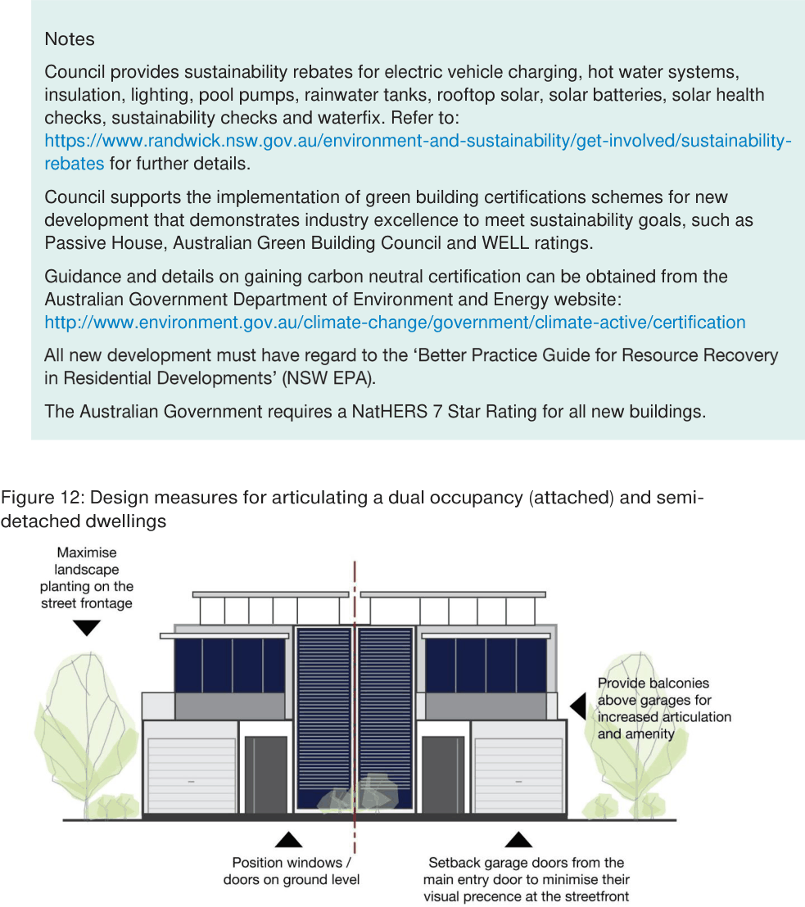

### 4.2. New semi-detached and dual occupancy (attached) dwellings

Explanation Dual occupancies (attached) sharing a single allotment and semi-detached dwellings, provide an alternative form of low-density housing choice. They have the potential for more significant environmental impacts than single dwellings due to the additional parking and access requirements and associated hard paved surfaces. Dual occupancies (attached) and semi-detached dwellings should aim to present a similar bulk and scale as a large single dwelling to integrate with existing streetscapes. The following are additional provisions which must be addressed in the design of new dual occupancies (attached) and semi-detached dwellings.

Definition RLEP dual occupancy (attached) means 2 dwellings on one lot of land that are attached to each other, but does not include a secondary dwelling. Further to the RLEP definition above, for the buildings to be attached, they must share a common wall.

Objectives

1\. To ensure the configuration, scale, massing and proportions of attached dual occupancies are compatible with other dwellings in the street

2\. To ensure parking facilities do not dominate the street elevations of dual occupancy dwellings, and instead present as an integrated element of the overall architectural composition

3\. To encourage the design of buildings that go beyond current minimum sustainable standards to benefit residents and the broader Randwick community.

Controls

a) The architectural design of dwellings must respect and enhance the architectural character of the streetscape

b) The front facade of dwellings must be designed to soften the visual dominance of parking facilities. This may include the following measures:

i. Place balconies or verandahs above garages

ii. Provide windows and/or doorways on the front elevation of the parking level, so that garage entries are not the sole façade elements

iii. Recess garage entries below cantilevered or projecting architectural elements.

c) The predominant built form of dwellings should be positioned towards the shared boundary to reduce visual bulk

d) The main entrance to dwellings must not be recessed behind the front facade alignment by more than 2m

e) Where garages face the primary street dwellings must only have a single car width garage

f) Where a dual occupancy or semi-detached dwellings are proposed on a corner allotment, each dwelling, and any associated garaging, should independently address a

street frontage. If both dwellings are proposed to be accessed from one street, car parking and driveways should not dominate the streetscape

g) Landscape planting or deep soil permeable surfaces should be maximised in between, or adjacent to driveways to improve visual presentation to the street

h) Dwellings are encouraged to incorporate PV rooftop solar and battery storage for the capture and use of energy for lighting, ventilation and services

i) Dwellings are encouraged to be 100% electric (no natural gas).

> [Picture on page 29: a picture, saved as a picture (images/part-c1-low-density-residential-page-29-8.gif, 150 dpi).]
> Words printed on the picture (title and legend, copied from the PDF):
> All new development must have regard to the ‘Better Practice Guide for Resource Recovery
> in Residential Developments’ (NSW EPA) .

Notes Council provides sustainability rebates for electric vehicle charging, hot water systems, insulation, lighting, pool pumps, rainwater tanks, rooftop solar, solar batteries, solar health checks, sustainability checks and waterfix. Refer to: https://www.randwick.nsw.gov.au/environment-and-sustainability/get-involved/sustainability-rebates for further details. Council supports the implementation of green building certifications schemes for new development that demonstrates industry excellence to meet sustainability goals, such as Passive House, Australian Green Building Council and WELL ratings. Guidance and details on gaining carbon neutral certification can be obtained from the Australian Government Department of Environment and Energy website: http://www.environment.gov.au/climate-change/government/climate-active/certification

The Australian Government requires a NatHERS 7 Star Rating for all new buildings.

Figure 12: Design measures for articulating a dual occupancy (attached) and semi-detached dwellings

Source: Randwick City Council 2022
