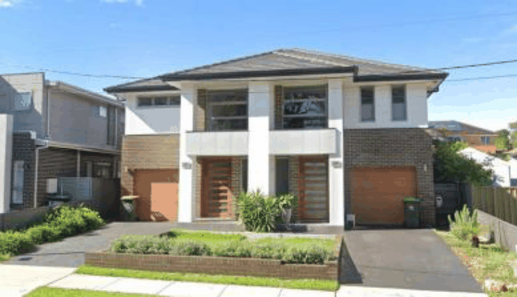
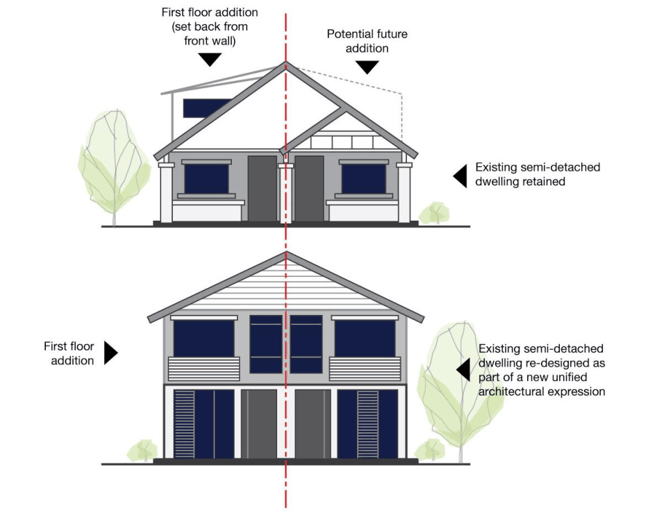

### 4.3. Alterations and additions to existing semi-detached and dual occupancy (attached) dwellings

Figure 13: Typical semi-detached / dual occupancy (attached) development

> [Picture on page 30: a picture, saved as a picture (images/part-c1-low-density-residential-page-30-4.gif, 150 dpi).]

Source: Randwick City Council

Explanation The following are additional provisions which must be addressed by proposals for symmetrical semi-detached dwellings on separate allotments and dual occupancy (attached) dwellings.

Objectives

1\. To ensure that redevelopment, or alteration and addition, to an individual semi-detached and dual occupancy (attached) dwelling recognises it as being half of a pair of symmetrical, similar, or complementary buildings

2\. To ensure development of semi-detached and dual occupancy (attached) dwellings are carefully integrated with the building to which it is attached, and takes into account any possible future development to the latter.

Controls

a) Alterations and additions must respect and enhance the architectural character of the pair of semi-detached and dual occupancy (attached) dwellings as a coherent entity

b) The design of the dwelling must be based on a detailed site and contextual analysis

c) Design solutions must respect the existing architectural expression and symmetry between the pair of semi-detached and dual occupancy (attached) dwellings and address:

i. Locating the bulk of any first floor level addition, setback from the principal street frontage and accommodated to the rear of the dwelling, with a substantial portion of the existing front roof remaining intact

ii. Positioning the addition behind the apex of existing hipped roofed houses. For gable roofs, additions should be setback from the gable end 100% of the height increase and retain any existing gable features and chimneys

iii. Designing the first floor level addition as a low profile roof form that is visually secondary to the existing front roof. Alternatively, the addition should adopt a roof form that is compatible with the style and period of the existing roof to be retained.

Notes The above controls are particularly important when altering or adding to semi-detached and dual occupancy (attached) dwellings in a Heritage Conservation Area (HCA). Refer to Part B2 Heritage of this DCP for further details. The above design solutions should not be used where the adjoining dwelling contains unsympathetic or poorly configured additions.

d) Alterations and additions to semi-detached and dual occupancy (attached) dwellings may be constructed to the common boundary with the adjoining dwelling

e) Avoid the exposure of existing blank party walls of the adjoining semi-detached dwelling to the public domain

f) Alterations and additions must seek to minimise the creation of exposed party walls at the common boundary. Where this is not feasible, the party walls must be appropriately finished

Note The owners of a pair of semi-detached dwellings or dual occupancy (attached) should coordinate with each other and present a consistent and integrated design approach. It is encouraged that a Development Application/s for both dwellings are submitted to Council concurrently.

g) Where a development application seeking first floor additions for both dwellings is not submitted concurrently, the later development application must be consistent with the built form massing of any adjoining, approved first floor addition including roof form, pitch and gutter lines

h) The selection of materials used for alterations and additions must enhance the character of the pair of semi-detached dwellings and result in a coordinated / holistic design outcome.

Figure 14: Possible design solutions for first floor additions to semi-detached and dual occupancy (attached) dwellings

> [Picture on page 32: a picture, saved as a picture (images/part-c1-low-density-residential-page-32-3.gif, 150 dpi).]

Source: Randwick City Council 2022

Note When adding a first floor level addition to an existing dwelling, set the first floor extension back behind the existing roof ridge (top), or alternatively create a new unified architectural character for the pair of dwellings (bottom).
