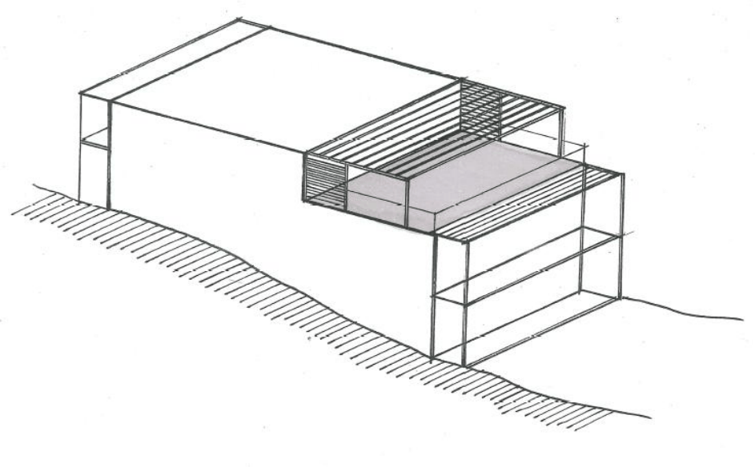

### 4.4. Roof terraces and balconies

Objectives

1\. To ensure trafficable roof spaces (eg. balconies or terraces) are integrated with the overall built form and architectural expression of the dwelling and maintain privacy in relation to neighbouring dwellings

2\. To ensure terraces do not result in adverse visual bulk or present as an additional storey

3\. To minimise visual and acoustic amenity impacts of trafficable roof spaces on surrounding properties

4\. To ensure that trafficable roof spaces allow for view sharing so that equitable access to views are provided from private property

5\. To ensure trafficable roof spaces are not the primary private open space and are not uncharacteristic of the area.

Controls

a) A roof terrace will be considered by Council on the uppermost or main roof of the building (including the principal dwelling and any outbuilding) if it is demonstrated that:

i. They are suitably located to prevent direct views to neighbouring habitable windows and private open spaces and will not result in unreasonable amenity impacts such as loss of privacy and acceptable noise

ii. The terrace does not exceed 12m2  in area

iii. They are designed to provide for view sharing, including minimising associated structures and roof top elements and are suitably located to prevent direct views to neighbouring habitable windows and private open spaces

iv. It is designed as a secondary private open space and does not to include entertainment facilities such as kitchens, BBQs or similar and shall incorporate screen planting where applicable to minimise impacts

v. The terrace and all elements of roof terraces shall comply with the maximum building height control and access to the terrace is provided within the envelope of the building.

b) For stepped buildings on sloping sites, a rooftop terrace may be provided on the roof other than the uppermost roof above the storeys below, provided the terrace complies with control a) and the additional following requirements:

i. The size is to be subservient to the roof form within which it is located

ii. It is designed as a secondary private open space and does not to include entertainment facilities such as kitchens, BBQs or similar

iii. Designed to provide for view sharing, including minimising associated structures and roof top elements

iv. It is to be uncovered, and all elements of roof terraces shall comply with the maximum building height control

c) Roof terraces above garages may only be provided on sloping sites, where the garages are located on the downhill side of the sites fronting the street, and are to comply with the controls outlined in this section

Note Existing roof terraces in a locality that do not comply with the above controls should not be utilised as precedent in seeking variations to the controls outlined in this section. This is to ensure that the objectives of low density residential development are met.

Figure 15: Stepped building acceptable example

> [Picture on page 34: a picture, saved as a picture (images/part-c1-low-density-residential-page-34-6.gif, 150 dpi).]

Source: Randwick City Council, 2022
