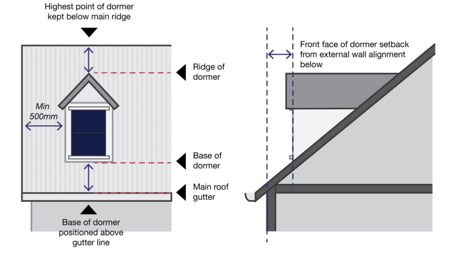
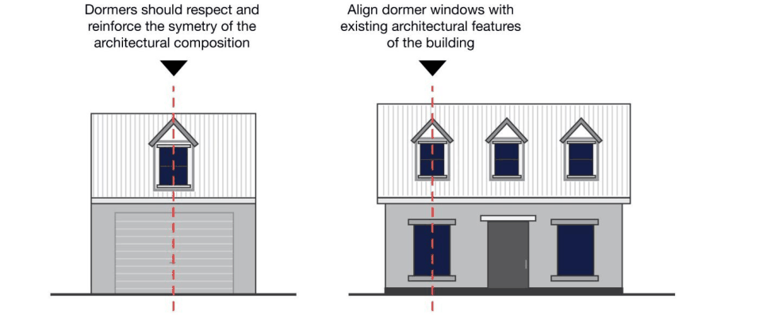

### 4.5. Roof design and features

Objectives

1\. To ensure the roof design integrates with the architectural form, proportions and façade composition of the building

2\. To ensure low density residential development maintains a two-storey height and frontage to the streetscape.

Controls Dormer windows

a) Dormer windows must be located and have a size, bulk and scale that do not dominate the roof form or add excessively to the building mass

b) The configuration of dormer windows must satisfy the following:

i. A maximum height from base to ridge of not more than 1.5m

ii. The highest point of a dormer must be situated below the ridge of the roof to which it is attached

iii. Dormers must be setback from the sides of the roof by a minimum of 500mm

iv. The front face of a dormer must be setback from the external face of the wall immediately below

v. The base of a dormer must be positioned above the gutter of the roof in which it is situated.

c) Dormers occurring in the same roof plane must be similarly sized, configured, and arranged symmetrically.

Figure 16: Dormer window configuration

> [Picture on page 35: a picture, saved as a picture (images/part-c1-low-density-residential-page-35-23.gif, 150 dpi).]

Source: Randwick City Council 2022

d) Dormer windows may only be provided on buildings with an architectural character or style that is suitable for dormer features.

Figure 17: Positioning of dormer windows on the roof plane

> [Picture on page 36: a picture, saved as a picture (images/part-c1-low-density-residential-page-36-2.gif, 150 dpi).]

Source: Randwick City Council 2022

Clerestory windows and skylights

e) The location, size, configuration and layout of clerestory windows and skylights must be sympathetic to the overall design of the dwelling and the streetscape.

Note Clerestory windows are defined as a section of high-level windows, located above eye level, that are designed to admit natural light and fresh air. In a dwelling it may be in the form of a band of narrow windows along the top of a wall below the finished ceiling level.

Mechanical equipment

f) Any plant and equipment must be contained within the roof form or screened behind parapet walls, so that they are not readily visible from the public domain and surrounding properties.
