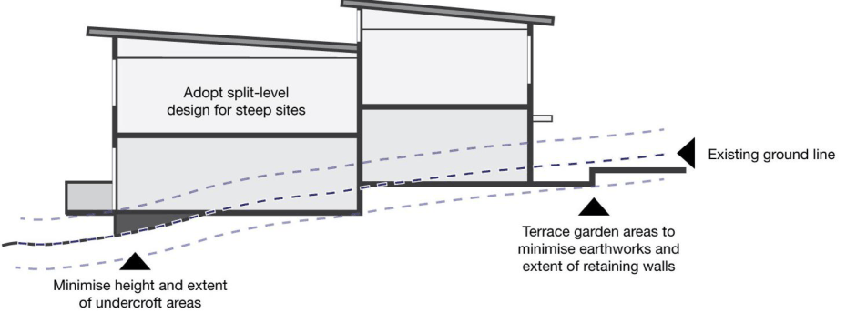
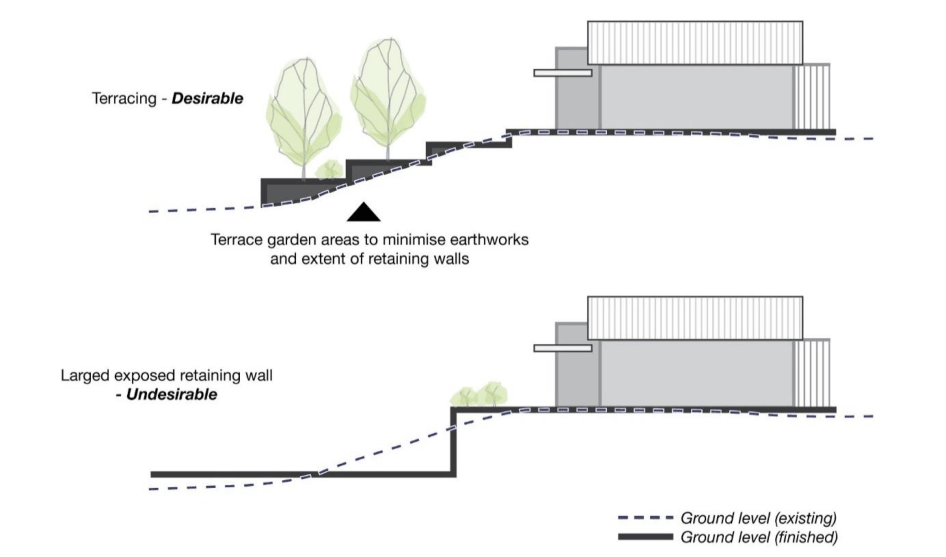

### 4.7. Earthworks

Objectives

1\. To maintain or minimise change to the natural ground levels, streetscape, and natural environment

2\. To ensure excavation and backfilling of a site does not result in unreasonable structural, visual, overshadowing and privacy impacts on the adjoining dwellings

3\. To provide usable private open space for dwellings with adequate gradient

4\. To ensure earthworks do not result in adverse stormwater impacts on adjoining properties

5\. To ensure earthworks do not impact upon the ability to achieve deep soil permeability surface areas and canopy tree planting

6\. To prevent the use of subterranean spaces as habitable areas.

Definitions RLEP Ground level (existing) is defined as the existing level of a site at any point Ground level (natural) is defined as the pre-modified ground level, prior to any alteration, cutting or filling.

Note Excavation for basements associated with dwelling houses, dual occupancies, or semi-detached dwellings is generally not encouraged. Council may consider basement excavation where:

- It is demonstrated that no reasonable alternative location exists on the site to accommodate parking and storage.

- The proposed works satisfies the objectives and controls of this Section and Part B8 Water Management of the Randwick DCP.

- Excavation does not add to the visual bulk and scale of the building

Controls

a) Any excavation for basements must have an area no greater than the space required to accommodate:

i. A maximum of 1 car space for dwellings with up to 2 bedrooms

ii. A maximum of 2 car spaces for dwellings with 3 or more bedrooms

iii. A plant room consistent with control g) of this sub section

iv. The basement does not exceed 3m in depth and is wholly contained within the building footprint

b) Any excavation and backfilling within the building footprint on a flat site must be limited to a maximum 1m at any point on the allotment, these requirements do not apply to swimming pool or spa pool structures

c) For sites with a significant slope where the site gradient is too steep to reasonably construct a dwelling, a merit assessment may be undertaken considering:

i. Site constraints

ii. Adverse impacts on adjoining properties

iii. Relevant geotechnical and stormwater management assessments

d) For sites with a significant slope, adopt a split-level design for dwellings to minimise excavation and backfilling, and design dwellings to minimise the height and extent of any exposed under croft areas

e) The outer edge of any excavation, piling or sub-surface walls must be setback a minimum of 900mm from the side and rear boundaries

f) Any excavation undertaken to create subterranean spaces must not be used as habitable space

g) The maximum area permitted for a plant room in any development is the minimum required to meet Australian Standards, accommodate typical dimensions of equipment required and the associated circulation space to access the equipment for maintenance. DA plans must show the approximate location and size of equipment within the plant room

h) Retaining walls are to be stepped in response to the natural landform to avoid creating monolithic structures, particularly where visible from the neighbouring dwellings and the public domain

i) Where it is necessary to construct retaining walls at less than 900mm from the side or rear boundary due to site conditions, retaining walls must be stepped to follow the topography of the land. Each stepping must not exceed a maximum height of 2.2m, as measured from the ground level (existing). In this case, the retaining walls may be incorporated as part of the boundary fence

j) For sites that slope upwards to the rear with the dwelling elevated above street level, the surface area of any blank retaining walls fronting the street must be minimised. Use a combination of materials to create articulation, and/or incorporate landscaping to visually soften the wall structures

k) Any cut and fill outside the building footprint (for the purposes of creating useable private open space) must not result in additional privacy and amenity impacts and shall consider boundary fencing heights and required retaining walls in response to changes.

l) Cut and fill outside the building footprint shall take the form of terracing following the natural landform in order to minimise the height or depth of earthworks at any point on the site. The appropriate extent of site modification will be assessed on a merit basis.

Figure 18: Measures for minimising earthworks

> [Picture on page 39: a picture, saved as a picture (images/part-c1-low-density-residential-page-39-32.gif, 150 dpi).]

Source: Randwick City Council 2022

Figure 19: Terracing of private open space to minimise cut and fill and extent of retaining walls

> [Picture on page 40: a picture, saved as a picture (images/part-c1-low-density-residential-page-40-3.gif, 150 dpi).]

Source: Randwick City Council 2022
