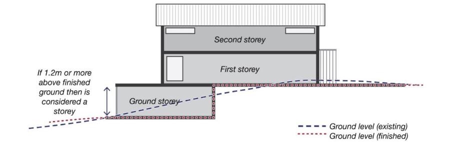

### 5.1. Solar access and overshadowing

Objectives

1\. To ensure new dwellings and alterations and additions are sited and designed to maximise solar access to the dwelling living areas and private open space

2\. To ensure development retains reasonable levels of solar access to neighbouring dwellings and their private open space

3\. To minimise overshadowing of existing, adjacent photovoltaic systems (solar panels) on neighbouring dwellings

4\. To provide adequate ambient daylight to dwellings and minimise the need for artificial lighting.

Controls Solar access to proposed development

a) A portion of the north-facing living area windows of proposed development must receive a minimum of 3 hours of direct sunlight between 9 am and 3 pm on 21 June (winter solstice) (In so far as it does not contradict any BASIX requirement)

b) The private open space of proposed development must receive a minimum of 3 hours of direct sunlight between 9 am and 3 pm on 21 June (winter solstice). The area covered by sunlight must be capable of supporting passive recreation activities.

Solar access to neighbouring development

c) A portion of the north facing living area windows of neighbouring dwellings must receive a minimum of 3 hours of direct sunlight between 9 am and 3 pm on 21 June (winter solstice)

d) The private open space of neighbouring dwellings must receive a minimum of 3 hours of direct sunlight between 9 am and 3pm on 21 June (winter solstice). The area covered by sunlight must be capable of supporting passive recreation activities

e) Existing solar panels on neighbouring dwellings, which are situated not less than 6m above ground level (existing), must retain a minimum of 3 hours of direct sunlight between 9 am and 3 pm on 21 June (winter solstice)

f) Where the neighbouring dwellings do not contain any solar panels, direct sunlight must be retained to the north, east and/or west roof planes of neighbouring dwellings, which are at least 6m above ground level (existing), so that future solar panels are able to capture 3 or more hours of sunlight between 9 am and 3 pm on 21 June

g) Where variation from the above controls is sought, applicants must provide sufficient written justification and will be subject to a merit assessment having regard to the following factors:

i. Degree of meeting the FSR, height, setback and site coverage controls

ii. Orientation of the subject and adjoining allotments and subdivision pattern of the urban block

iii. Topography of the subject and adjoining allotments

iv. Location and level of the windows in question

v. Shadows cast by existing buildings on the neighbouring allotments.

Figure 20: Determining number of storeys within a development

> [Picture on page 42: a picture, saved as a picture (images/part-c1-low-density-residential-page-42-18.gif, 150 dpi).]

Source: Randwick City Council 2023

Notes: Shadow diagram requirements Shadow diagrams are required for all new buildings and alterations and additions which are two or more storeys. Shadow diagrams must clearly show existing and future shadows at 9 am, 12 noon and 3 pm on 21 June (winter solstice) at a suitable scale. Hourly interval shadow diagrams are to be provided for east-west orientated sites and any applications seeking variation to the building form (i.e. FSR, height, setbacks). Elevational shadow diagrams are required for buildings which have an impact on adjoining north facing living room windows and Private Open Space (for low density residential developments) and any living room windows (for other residential developments). North facing living room windows at neighbouring properties are to be provided on all shadow diagrams and elevational shadows. Shadow impacts The development of some sites due to orientation and / or topography, may result in unavoidable overshadowing or impacts on solar access, which arise due to unique site circumstances, rather than due to inappropriate design. In this case the design will be assessed on merit at the DA stage.
