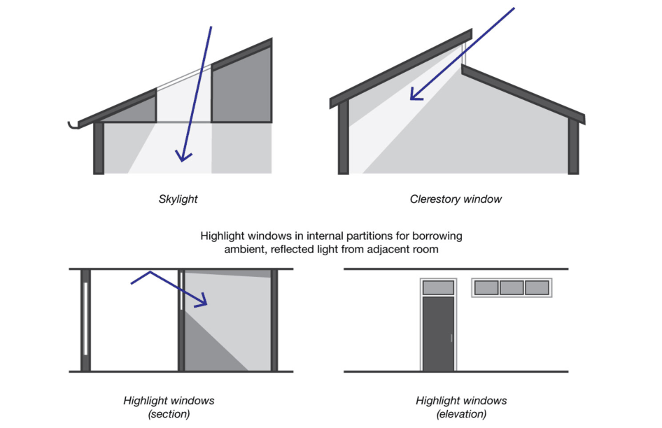

### 5.2. Energy efficiency and natural ventilation

Objectives

1\. To contribute positively to the reduction in energy consumption and greenhouse gas emission during the occupation and use of buildings

2\. To enhance the amenity of indoor areas via the use of natural lighting and ventilation.

Controls

a) Provide daylight to the internal areas of the dwelling (hallway, stairwell, walk-in-wardrobe and the like), and any poorly lit habitable rooms, through design measures such as:

i. Skylights

ii. Clerestory windows

iii. Fanlights above doorways

iv. Highlight windows in internal partition walls.

Figure 21: Measures for optimising daylight access to interior space of dwellings

> [Picture on page 43: a picture, saved as a picture (images/part-c1-low-density-residential-page-43-14.gif, 150 dpi).]

Source: Randwick City Council 2022

b) Where possible, provide natural lighting and ventilation to any internal toilets, bathrooms, and laundries within the dwelling through design measures such as ventilated skylights

c) All habitable rooms (that is, living rooms, dining rooms, rumpus rooms, kitchens and bedrooms) must incorporate window opening to outdoor areas. The sole reliance on skylights or clerestory windows for natural lighting and ventilation is not acceptable.
