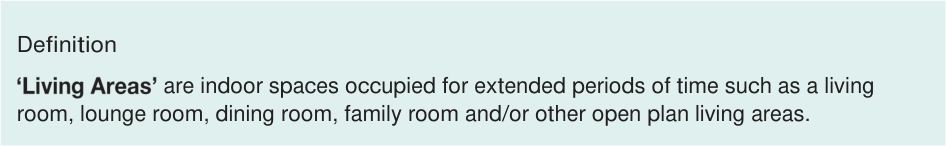
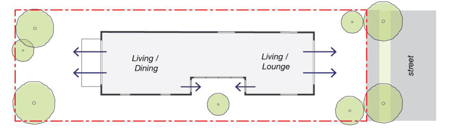

### 5.3. Visual privacy

Explanation Skilful design of buildings can optimise privacy by minimising cross viewing and the overlooking of the living spaces of adjoining dwellings. In the urban context, complete privacy between dwellings is often not completely achievable or practicable. The following visual privacy controls seek to minimise cross viewing and overlooking from the indoor and outdoor living areas of dwellings to maintain the amenity of neighbouring properties.

Objective

1\. To ensure that development minimises overlooking or cross-viewing of neighbouring dwellings to maintain reasonable levels of privacy.

Controls

a) Where unique site conditions occur, or in the case of NSW Pattern Book developments, exceptions are assessed on merit, with consideration of the design of the relevant building to mitigate potential issues of visual privacy

b) All habitable room windows must be located to minimise any direct viewing of existing habitable room windows in adjacent dwellings by one or more of the following design measures:

i. Offsetting or staggering windows away from those of the adjacent building

ii. Setting the window sills at a minimum of 1.6m above finished floor level

iii. Installing fixed and translucent glazing up to a minimum of 1.6m above finished floor level

iv. Installing fixed privacy screens outside the windows in question

v. Creating a recessed courtyard on the side elevations of a building measuring not less than 3m x 2m in size, with windows opening towards the courtyard in lieu of the common boundary.

c) The windows of living areas must be oriented away from the windows of adjacent dwellings wherever possible. In this respect, they may be oriented to:

i. The front or rear of the allotment

ii. A side courtyard.

> [Picture on page 44: a picture, saved as a picture (images/part-c1-low-density-residential-page-44-30.gif, 150 dpi).]
> Words printed on the picture (title and legend, copied from the PDF):
> Definition
> ‘Living Areas’ are indoor spaces occupied for extended periods of time such as a living

room, lounge room, dining room, family room and/or other open plan living areas.

d) Focus upper floor balconies to the street or rear garden of the site. Any elevated balconies, or balcony returns on the side façade, must have a narrow width to minimise privacy impacts on the adjoining properties

Figure 22: Preferred orientation of main living / dining room windows

> [Picture on page 45: a picture, saved as a picture (images/part-c1-low-density-residential-page-45-2.gif, 150 dpi).]

Source: Randwick City Council, 2022

e) Balconies, decks, and terraces on steeply sloping sites must minimise overlooking through careful positioning and orientation

f) Where a balcony, deck or terrace is likely to overlook the Private Open Space or windows of the adjacent dwellings, privacy screens must be installed in positions suitable to mitigate the loss of privacy. The use of privacy screens should be a secondary mitigation device where overlooking is primarily mitigated through positioning and orientation. Privacy screens must be permanently fixed and have a minimum height of not less than 1.6m, as measured from the finished floor level. Privacy screens must achieve a minimum of 70% opaqueness and may be constructed with:

i. Translucent or obscured glazing

ii. Fixed timber or metal slats mounted horizontally or vertically

iii. Fixed vertical louvres with the individual blades oriented away from the private open space or windows of the adjacent dwellings.

g) Screen planting and planter boxes may be used as a supplementary device for reinforcing privacy protection. However, they must not be used as the sole privacy protection measure

h) For sloping sites, any ground floor decks, or terraces must step down in accordance with the landform, and avoid expansive areas of elevated outdoor recreation space.

Note The use of adjustable louver privacy screening that enables a balcony, deck or terrace to become enclosed may result in the floor area being considered as part of the total building GFA calculation.
