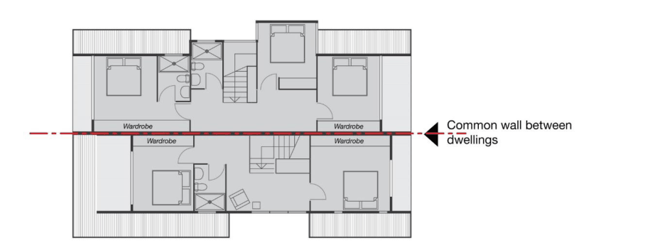

### 5.4. Acoustic privacy

Explanation The skilful design of buildings and uses can minimise noise intrusion to an adjoining dwelling. The emphasis is on controlling noise generation from the indoor and outdoor living areas of dwellings, which are more critical in maintaining the amenity of neighbouring dwellings. Objectives

1\. To ensure the siting and design of development minimises the impact of noise transmission between dwellings

2\. To ensure the siting and design of development minimises impacts from significant noise sources outside the property, such as arterial roads, flight paths, industry and port operations.

Controls

a) Dwellings must be sited and designed to limit the potential for excessive noise transmission to the sleeping areas of adjacent dwellings. Accordingly, main living room windows, balconies and terraces, barbeques, swimming pools and spa pools must not be located immediately adjacent to the bedroom windows of adjoining dwellings

b) Attached dual occupancies must be designed to reduce noise transmission between dwellings via the following measures:

i. Locate noise-generating areas adjacent to each other, and quiet areas next to each other (for instance, living rooms to living rooms, bedrooms to bedrooms)

ii. Locate less sensitive areas, such as stairways, store rooms, toilets, walk-in-wardrobes, built-in-wardrobes and the like adjacent to the party wall for both dwellings to serve as a noise buffer

iii. Avoid locating wet areas, such as toilets, laundries, and kitchens, adjacent to the bedrooms of the adjoining dwelling

Figure 23: Room layout to minimise noise transmission between dwellings sharing a common wall

> [Picture on page 46: a picture, saved as a picture (images/part-c1-low-density-residential-page-46-28.gif, 150 dpi).]

Source: Randwick City Council, 2022

c) Development affected by noise from road traffic, aircraft and industrial and port operations must be designed and constructed in accordance with the relevant Australian Standards and guidelines (as a minimum) issued by the relevant agencies and authorities. As a minimum, the bedroom windows must be oriented away from the noise source wherever possible. Depending on the level of noise impact, developments are

encouraged to exceed minimum noise standards to achieve a high standard of internal amenity

d) Where unique site conditions occur, or in the case of NSW Pattern Book developments, exceptions are assessed on merit, with consideration of the siting and design of the relevant building, room or outdoor terrace/balcony, to mitigate potential issues of acoustic privacy.
