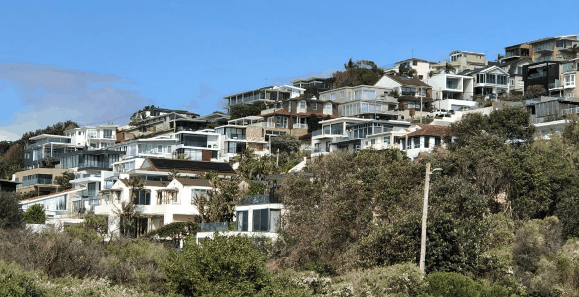

### 5.6. View sharing

Explanation Many dwellings and public places in Randwick City enjoy views to the ocean, coastline, parks and the distant skyline of the Sydney CBD and Bondi Junction. Some elements are recognised as prominent natural features (such as Wedding Cake Island) or significant man-made artefacts and carry scenic and iconic values. The concept of view sharing relates to the equitable distribution of views between development and neighbouring dwellings and the public domain. The view sharing Control aims to achieve a balance between facilitating quality development and preserving an equitable amount of views for the surrounding properties as far as is practicable and reasonable. Figure 24: View sharing principles are particularly applicable in coastal locations

> [Picture on page 48: a picture, saved as a picture (images/part-c1-low-density-residential-page-48-12.gif, 150 dpi).]

Source: Randwick City Council, 2022 View sharing does not prescribe the total retention of all significant views and vistas. In established inner metropolitan areas like Randwick City, development may result in some degree of view loss. The intent of the DCP is to ensure development is sensitively and skilfully designed, so that a reasonable level of existing views are retained for residents and the public to enjoy. The NSW Land and Environment Court has developed a Planning Principle relating to view sharing based on the case of Tenacity Consulting v Warringah Council [2004] NSWLEC 140. Where view loss impact is likely to occur, development proposals must address this subsection of the DCP as well as the aforementioned Planning Principle in detail in a DA submission. Objectives

1\. To acknowledge the value of views to significant scenic elements, such as ocean, bays, coastlines, watercourses, bushland and parks, as well as recognised icons, such as city skylines, landmark buildings / structures and special natural features

2\. To protect and enhance views from the public domain, including streets, parks and reserves to significant scenic elements and recognised icons

3\. To ensure development is sensitively and skilfully designed to maintain a reasonable amount of views from the development, neighbouring dwellings and the public domain.

Controls

a) The location and design of dwellings and outbuildings must reasonably maintain existing view corridors or vistas from the neighbouring dwellings, streets and public open space areas

b) In assessing potential view loss impacts on the neighbouring dwellings, retaining existing views from the living areas (such as living room, dining room, lounge and kitchen) should be given a priority over those obtained from the bedrooms and non-habitable rooms

c) Where a design causes conflicts between retaining views for the public domain and private properties, priority must be given to view retention for the public domain

d) The design of fences and selection of plant species must minimise obstruction of views from the neighbouring dwellings and the public domain

e) Design of proposals must demonstrate a balanced approach to privacy protection and view sharing and avoid the creation of long and massive blade walls or screens that obstruct views from the neighbouring dwellings and the public domain

f) Development applications must clearly demonstrate and explain measures adopted to mitigate potential view loss impacts.

Note To facilitate assessment of potential view loss impacts, Council may request the installation of height poles on the development site to demonstrate the height and envelope of the works. The height poles must be checked and certified by a Registered Surveyor as being accurate with relevant certification submitted to Council.
