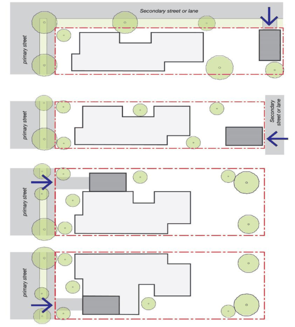

### 6.1. Location of parking facilities

Controls All dwellings

a) Provide a maximum of one vehicular access per property

b) Locate parking facilities off rear lanes, or secondary street frontages in the case of corner allotments, where available

c) Where rear lane or secondary street access is not available, parking facilities must be located behind the front façade alignment, either integrated within the dwelling or positioned to the side of the dwelling

d) Provide a single width garage or carport facing the primary street if the site frontage has a width of less than 12m

e) A double width garage or carport may only be provided where:

i. The frontage width is at least 12m; and

ii. The development is consistent with the predominant pattern in the street; and

iii. The minimum deep soil permeable surfaces area in the front setback is achieved.

f) A tandem car parking garage or single garage and a carport, or hardstand space in front of a single garage, will be considered where two car parking spaces are required for a dwelling. Refer to B7 Transport, Traffic and Parking in the Randwick DCP

g) Avoid long driveways that require large expanses of impermeable surfaces Dual occupancies and new semi-detached dwellings

h) For semi-detached and dual occupancy dwellings with parking facilities accessed off the primary street, provide a single width garage or carport, including a hard stand parking space in front measuring 2.4m (wide) x 5.4m (deep)

i) For dual occupancy and semi-detached dwellings with parking facilities accessed off rear laneways, or secondary street frontages in the case of corner allotments, double width garages may be provided where the development is consistent with the predominant pattern in the street

j) One vehicular access for each dwelling will only be considered where the following requirements are met:

i. The minimum deep soil permeable surfaces area and tree planting requirements within the front setback are achieved; and

ii. It is demonstrated that at least one parallel on-street parking space is maintained; and

iii. No net loss of street trees occurs.

Note See also Section 5.2 for circumstances where parking facilities forward of the front façade alignment may be considered.

Figure 25: Indicative layout of parking facilities as specified in controls above

> [Picture on page 51: a picture, saved as a picture (images/part-c1-low-density-residential-page-51-25.gif, 150 dpi).]

Source: Randwick City Council, 2022
