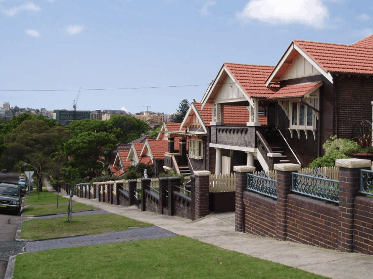

### 6.2. Parking facilities forward of front façade alignment

Controls

a) Where the provision of parking facilities behind the front façade alignment is not feasible (due to the absence of rear lane or secondary street access, narrow site width, irregular allotment configuration, or retention of an existing dwelling), parking facilities may be provided within the front setback areas as follows:

i. An uncovered single car space; or

ii. A single carport having an external width of not more than 3m (excluding eaves); and

iii. Landscaping must be able to be incorporated into the site frontage.

Figure 26: A single hardstand car space or a single carport may be provided in front of a dwelling on constrained sites. Landscaping must be able to be incorporated into the site

> [Picture on page 52: a picture, saved as a picture (images/part-c1-low-density-residential-page-52-13.gif, 150 dpi).]

frontage.

Source: Randwick City Council

b) Regardless of the site frontage width, the provision of garages or carports within the front setback areas may only be considered where:

i. There is no alternative, feasible location for accommodating carparking

ii. The site has a significant slope with the dwelling being elevated above the street

iii. The garage or carport will not adversely affect the visual amenity of the street and the surrounding areas

iv. The garage or carport location will not pose an undue risk on the safety of pedestrians

v. The garage or carport will not require the removal of significant landscape elements that enhance the streetscape, such as rock outcrop or sandstone retaining walls

vi. The garage design compliments the architectural character, design elements and materials and finishes of the primary dwelling eg. roof type / pitch and finishes.
