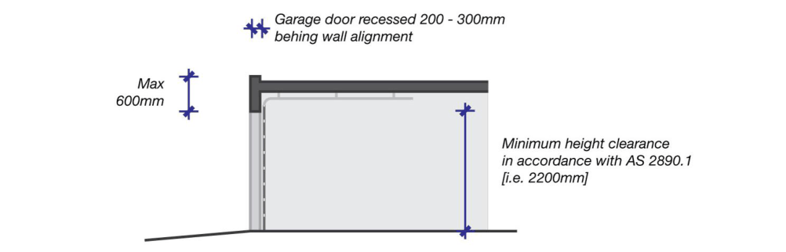

### 6.5. Garage configuration

Controls

a) Garages must be recessed behind the front façade alignment of the dwelling on both the primary and secondary street elevations

b) The maximum internal width of a garage (including the garage door and the flanking piers or columns) is:

i. Single garage

– 3m

ii. Double garage

– 6m

c) The minimum internal length of a garage is 5.4m

d) The minimum width of a new garage door is:

i. Single garage door

– 2.4m

ii. Double garage door

– 4.8m

e) The maximum wall height of detached garages fronting the street is 2.6m and maximum building height of 3m for a pitched roof

f) Garage doors must not be flush with the alignment of the garage walls. The garage door should be recessed between 200mm and 300mm behind the alignment of the front garage walls, to provide articulation

g) The height of any parapet wall or bulkhead above the garage entry must not exceed 600mm, to minimise the visual bulk of the garage.

Figure 27: Measures for minimising visual bulk of garages

> [Picture on page 54: a picture, saved as a picture (images/part-c1-low-density-residential-page-54-4.gif, 150 dpi).]

Source: Randwick City Council 2022
