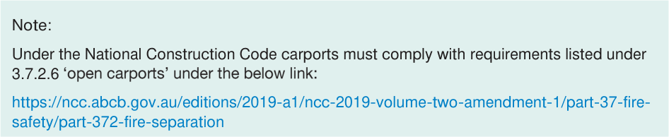
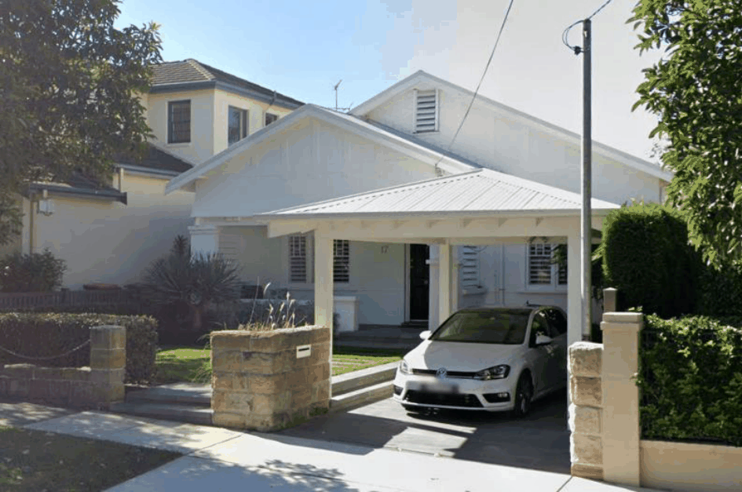

### 6.6. Carport configuration

Controls

a) Carports must have a simple, post-support design and not solid enclosing walls. The carport may only be semi-enclosed with timber or metal slats achieving a minimum 30% of open area

b) The carport must have a flat roof, lean-to roof, gable or hipped roof having a pitch angle and design that relates to the dwelling or the predominant street character. The roof must not be trafficable

c) The maximum width of a carport is:

i. Single carport – 3m

ii. Double carport

– 6m

d) The minimum length of a carport is 5.4m

e) The maximum building height of carports is 2.6m for a flat roof or 3m for a pitched roof

f) Carports must not use a solid panel or roller shutter door

g) The carport may be secured by a gate having a minimum of 30% open area

h) Carport gates must not encroach upon public land during operation.

> [Picture on page 54: a picture, saved as a picture (images/part-c1-low-density-residential-page-54-23.gif, 150 dpi).]
> Words printed on the picture (title and legend, copied from the PDF):
> ‘open carports’ under the below link:

Note: Under the National Construction Code carports must comply with requirements listed under 3.7.2.6 https://ncc.abcb.gov.au/editions/2019-a1/ncc-2019-volume-two-amendment-1/part-37-fire-safety/part-372-fire-separation

Figure 28: Carport forward of front façade alignment example

> [Picture on page 55: a picture, saved as a picture (images/part-c1-low-density-residential-page-55-2.gif, 150 dpi).]

Source: Randwick City Council 2022
