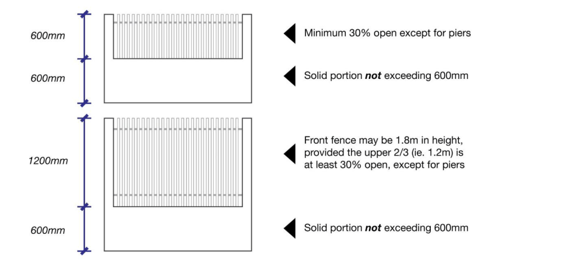

### 7.2. Front fencing

Controls

a) The maximum height of front fencing is limited to 1.2m, as measured from the footpath level, with the solid portion not exceeding 600mm, except for piers. The maximum height of front fencing may be increased to 1.8m, provided the upper two-thirds are partially open, except for piers

b) Construct the non-solid portion of the fence with light weight materials (such as timber panels, slats or the like) that are at least 30% open and evenly distributed along the full length of the fence

c) A solid front fence of up to 1.8m in height may be permitted in the following scenarios:

i. A front fence for sites facing arterial roads subject to case-by-case assessment; or

ii. A fence on the secondary street frontage of corner allotments, which is behind the alignment of the primary street façade. The fence must be tapered down to

match the height of the primary street fence, once past the front façade alignment

Such solid fences must be articulated through a combination of materials, finishes and details, and incorporate landscaping (such as cascading plants), to avoid continuous blank walls

Figure 29: Configuration of front fencing

> [Picture on page 57: a picture, saved as a picture (images/part-c1-low-density-residential-page-57-7.gif, 150 dpi).]

Source: Randwick City Council

d) The fence must incorporate stepping to follow any change in level along the street boundary. The height of the fence may exceed the aforementioned numerical requirement by a maximum of 150mm adjacent to any stepping

e) The preferred materials for front fences are natural stone, face bricks and timber. Cast or wrought iron pickets may be used where they are compatible with the character of the building and the streetscape

f) Avoid roofed entry portal, unless designed to complement any established fencing pattern in heritage streetscapes

g) Gates must not open over public land

h) The fence must align with the front property boundary or the predominant fence setback line along the street

i) The fence adjacent to the driveway may be required to be splayed to ensure adequate sightlines for drivers and pedestrians.
