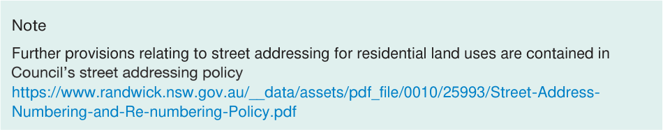

### 8.7. Street addressing

Explanation Under the Local Government Act 1993 and the NSW Address Policy, Council is the designated authority responsible for allocating property addresses. All addressing must comply with the standards set out in the NSW Address Policy and User Manual. Council will allocate and where necessary, amend street numbers in a manner that is consistent, clear, and fit for purpose, considering statutory requirements, public interest, and relevant information provided by applicants. The objective is to maintain a uniform addressing system that supports emergency services, public safety, efficient service delivery, and ease of navigation.

> [Picture on page 61: a picture, saved as a picture (images/part-c1-low-density-residential-page-61-17.gif, 150 dpi).]
> Words printed on the picture (title and legend, copied from the PDF):
> Council’s street addressing policy
> https://www.randwick.nsw.gov.au/__data/assets/pdf_file/0010/25993/Street-Address-
> Numbering-and-Re-numbering-Policy.pdf

Note Further provisions relating to street addressing for residential land uses are contained in
