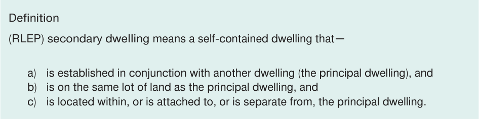
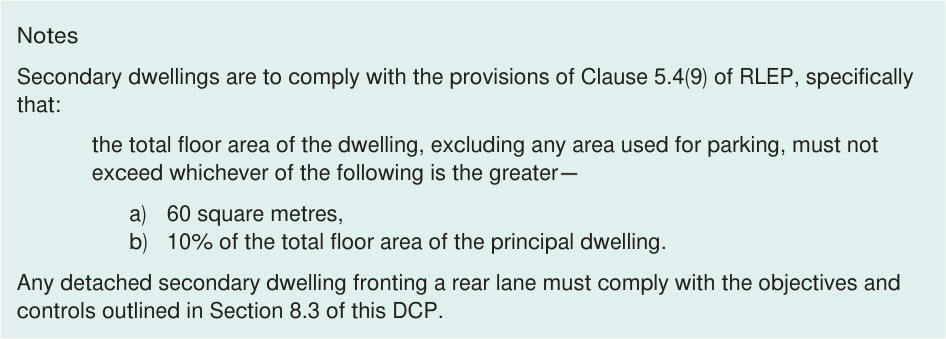

### 8.8. Secondary dwelling

> [Picture on page 61: a picture, saved as a picture (images/part-c1-low-density-residential-page-61-21.gif, 150 dpi).]
> Words printed on the picture (title and legend, copied from the PDF):
> —

Definition (RLEP) secondary dwelling means a self-contained dwelling that

a) is established in conjunction with another dwelling (the principal dwelling), and

b) is on the same lot of land as the principal dwelling, and

c) is located within, or is attached to, or is separate from, the principal dwelling.

Objectives

1\. To ensure that secondary dwellings present as ancillary structures associated with a principal dwelling

2\. To ensure that secondary dwellings do not significantly impact upon the privacy and amenity of neighbouring properties

3\. To ensure secondary dwellings achieve acceptable levels of building design, amenity, accessibility and security

4\. To ensure appropriate setbacks for landscaping and to retain existing deep soil permeable surfaces and open space of the overall lot.

Controls

a) Except for laneway development, secondary dwellings must be single storey and must not exceed a maximum height of 3.6m and a wall height of 2.4m

b) Side setbacks of secondary dwellings are to be determined on a site-by-site basis, with consideration given to:

i. The orientation, existing windows and amenity of neighbouring properties

ii. The location and height of any proposed windows or openings that face adjoining properties

iii. Existing solar access to the principal dwelling and any adjoining neighbouring properties.

iv. External wall finishes, any required maintenance and relevant NCC requirements.

c) Secondary dwellings that do not front a rear lane must be set back at least 3 meters from the rear boundary

d) Any access to a secondary dwelling located above a garage must be via a separate ground floor entrance, not via the garage space.

e) Windows on all elevations, including those orientated towards the principal dwelling, are positioned or appropriately screened to avoid direct overlooking.

f) A minimum area of 8m2, with a minimum width of 2m is to be provided for private open space for the secondary dwelling.

> [Picture on page 62: a picture, saved as a picture (images/part-c1-low-density-residential-page-62-21.gif, 150 dpi).]

Notes Secondary dwellings are to comply with the provisions of Clause 5.4(9) of RLEP, specifically that: the total floor area of the dwelling, excluding any area used for parking, must not exceed whichever of the following is the greater —

a) 60 square metres,

b) 10% of the total floor area of the principal dwelling.

Any detached secondary dwelling fronting a rear lane must comply with the objectives and controls outlined in Section 8.3 of this DCP.
