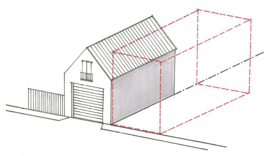

### 8.10. Development adjoining laneways

Explanation Housing development in the north and central parts of the Randwick City LGA dates to the late 19th and early 20th centuries. Development in these periods feature narrow, elongated blocks serviced by rear laneways. The rear laneways are generally narrow and shared by pedestrians, private and service vehicles. The visual amenity, and the real and perceived safety and security of many laneways is limited. This subsection provides general guidance on the appropriate forms of ancillary development for laneways, with the aim of promoting their safety, security and visual appearance.

Definition A laneway is defined as a narrow (generally 6m wide or less) road, right of way or right of carriageway, in either public ownership or under public responsibility, which provides access to the side or rear of allotments principally for the purpose of servicing adjoining land uses and activities.

Objectives

1\. To ensure any building fronting a rear lane has a scale and mass appropriate for the width of the lane and is secondary to the principal dwelling on the site

2\. To increase passive surveillance to improve safety and security in laneways

3\. To ensure secondary dwellings enhance the appearance and streetscapes of laneways and adjoining streets.

Controls

a) All buildings fronting laneways must have a maximum height of not more than 6m and the maximum external wall height is limited to 4.5m.

b) Buildings on laneways must have a mass and scale secondary to the principal dwelling on the lot.

Note The above controls do not apply to detached dual occupancies in the Zone R3 Medium Density Residential.

c) Any upper level (for instance, a storey above the garage) must be contained within the roof form as an attic storey

d) The laneway elevation of any upper level must provide at least one window to a habitable space to enable passive surveillance of the rear lane

e) Where there is a consistent setback pattern along the lane, buildings must be aligned in accordance with that setback. Where there is no consistent setback pattern, buildings must be setback a minimum of 1m from the laneway boundary (refer to subsection 6.3 Setbacks of parking facilities for controls relating to the setback of garage entries)

f) Laneway development may have a zero setback from the side boundaries in the following scenarios:

i. The adjoining site already contains a building at the rear constructed to the common boundary; and

ii. A zero side setback will not result in unreasonable visual, privacy and overshadowing impacts on the adjoining properties.

g) Laneway development must screen or match any exposed blank walls within the adjoining properties that are near to, or abut, the common / side boundaries.

Figure 30: Laneway development may be built to the common boundary, if the adjoining site already contains a building constructed to the boundary, or where no unreasonable impacts will result.

> [Picture on page 64: a picture, saved as a picture (images/part-c1-low-density-residential-page-64-34.gif, 150 dpi).]

Source: Randwick City Council

1300 722 542

Randwick City Council

30 Frances Street

council@randwick.nsw.g ov.au
