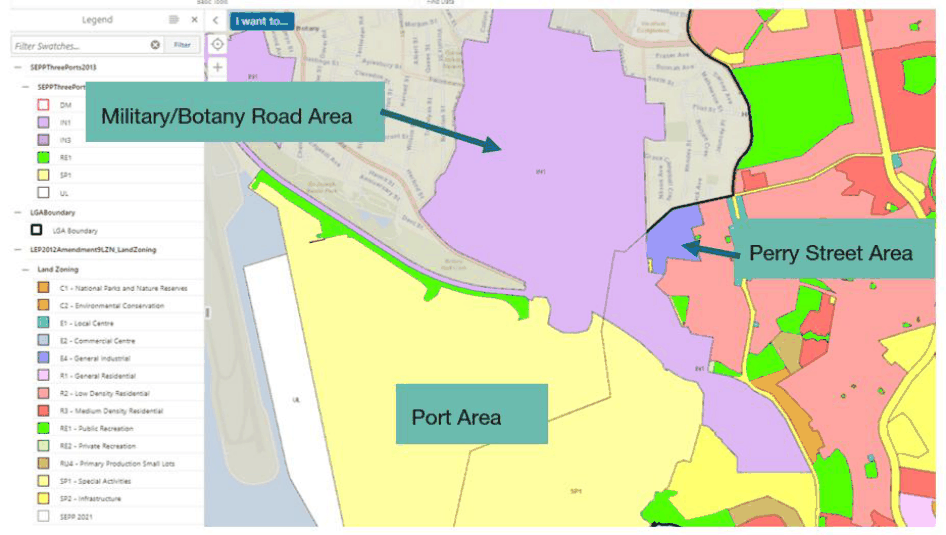
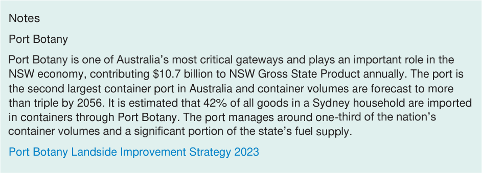

### 1.3. Industrial precincts

The industrial land located within the Randwick Local Government Area (LGA) comprises two distinct precincts, each of which exhibits a different urban structure, lot configuration and operational typology, supporting a diversity of industrial uses and business types. These two areas are illustrated in Figure 1.

Figure 1: Industrial precincts map

> [Picture on page 5: a picture, saved as a picture (images/part-c10-industrial-areas-page-5-25.gif, 150 dpi).]

Source: Randwick City Council 2022

Perry Street Area The Perry Street Area Zoned E4 zone

– General Industrial is characterised by small and

individual allotments accommodating a range of light industrial and service-based uses, including wholesale food distributors, building supplies, warehouses and distribution centres, and transport related activities that support the broader economy. The desired future character of the precinct is to retain and support a diverse range of small and medium sized tenancies (including strata developments) to ensure ongoing viability of smaller-scale industrial premises. The Matraville industrial precinct will continue to function as a strategically important employment area supporting the Eastern Suburbs and the broader metropolitan economy, particularly through its proximity to Port Botany, Sydney Airport and the arterial road network. The precinct will consolidate its role as a modern, high‑functioning industrial and urban services hub, accommodating a diverse mix of warehousing and logistics operations, light industrial and manufacturing uses, building and trade suppliers, and service-based industries that support the daily needs of the surrounding community. Given the proximity of residential areas, careful management of the interface between the intensive port operations and sensitive land uses within the surrounding low density residential area is essential. Development should be designed and operated to minimise potential impacts. Council has implemented a range of local traffic management measures to mitigate the impacts of industrial operations on adjoining residential areas. This includes the designation of Perry Street with a vehicular weight restriction of 3.4 tonnes, limiting access by heavy vehicles. In addition, the existing traffic arrangement at the Perry Street and McCauley Street intersection incorporates a traffic island that physically restricts turning movements, effectively preventing heavy vehicles from accessing Perry Street. These measures play an important role in reducing heavy vehicle traffic, improving residential amenity, and enhancing the safety and functionality of the local road network.

The Botany Road/Military Road area The Botany Road/Military Road area, zoned IN1

– General Industrial under the Transport and

Infrastructure SEPP is characterised by medium to large lots. The desired future character of the precinct is to retain these large allotments that accommodate a range of established industrial and logistics uses.  The desired future character of the precinct is to retain and reinforce this larger lot pattern to support the ongoing operation of industrial activities requiring significant floor space, site manoeuvrability and efficient access for freight and servicing. Subdivision that results in small or fragmented lots, including strata subdivision, is discouraged where it would compromise the capacity of the precinct to accommodate larger-scale and port-related industrial uses.

Port Botany Area The Port Botany area, zoned SP1

– Special Activities under the State Environmental Planning

Policy (Transport and Infrastructure), is a strategic industrial precinct of State significance that supports port operations and associated industries. The desired future character of the precinct is to maintain and protect land for port and port-related uses that require large allotments, high-capacity infrastructure, and direct access to major road and rail freight networks. Development within this area must ensure the ongoing efficiency and operational capacity of the port, while avoiding land fragmentation or incompatible uses that may constrain its long-term function.

> [Picture on page 7: a picture, saved as a picture (images/part-c10-industrial-areas-page-7-1.gif, 150 dpi).]
> Words printed on the picture (title and legend, copied from the PDF):
> Notes
> Port Botany
> third of the nation’s
> Port Botany is one of Australia’s most critical gateways and plays an important role in the
> container volumes and a significant portion of the state’s fue l supply.

NSW economy, contributing $10.7 billion to NSW Gross State Product annually. The port is the second largest container port in Australia and container volumes are forecast to more than triple by 2056. It is estimated that 42% of all goods in a Sydney household are imported in containers through Port Botany. The port manages around one-

Port Botany Landside Improvement Strategy 2023

Objectives The objectives for this DCP chapter are to:

1\. Retain and protect the industrial zoned land within the Matraville area to meet the current and future industrial, urban services and employment needs of the Randwick LGA

2\. Ensure land use compatibility and efficiency by retaining small allotments within the Perry St Area to support small-scale and local industrial businesses and maintaining larger allotments within the Botany Rd/Military Rd and Port Botany areas to accommodate large-scale, logistics and port-related industrial activities

3\. Encourage light industrial and low impact employment uses in locations adjoining residential areas having regard to noise, traffic generation, hours of operation and environmental performance

4\. Facilitate industrial development that provides a range of goods and services and employment opportunities, while ensuring the amenity, health and safety of the nearby residential areas are not adversely affected

5\. Ensure industrial development is well-designed with a high quality streetscape presentation, and operates to minimise adverse impacts on land, water and the environment including through appropriate stormwater management, waste handling and emissions control

6\. Ensure that new industrial development does not increase the cumulative risk of industrial activities or introduce unacceptable risks including those associated with hazardous materials, heavy vehicle movements noise and vibration

7\. Allow compatible, small-scale non-industrial uses which support the daily needs of workers within the industrial areas, where they do not compromise the primary industrial function of the land

8\. Maintain the primacy of industrial activities by ensuring that commercial and office uses, including standalone offices, are only permitted where they are subordinate and directly related to an associated industrial use

9\. Support existing and encourage new artisan food and drink production, distribution and urban service uses that contribute to the local economy and service the Eastern Suburbs region, where these are compatible with the surrounding land use context.

Notes The National Heavy Vehicle Regulator NHVR manages road access and permits for heavy vehicle journeys. It was formed through an agreement between the Australian, New South Wales, Queensland, Victorian, South Australian, Tasmanian and Australian Capital Territory governments. The Heavy Vehicle National Law (HVNL) came into effect in New South Wales in 2014. The NHVR work directly with road managers - state and territory road authorities and local government - to coordinate the application process and issue permits. They manage access and permits for restricted vehicles including B double Trucks and articulated vehicles. See the National Heavy Vehicle Regulator National Network Map for approved routes. Large, restricted access vehicles including B doubles and articulated vehicles must utilise approved B Double approved routes. Port Botany Landside Improvement Strategy 2023
