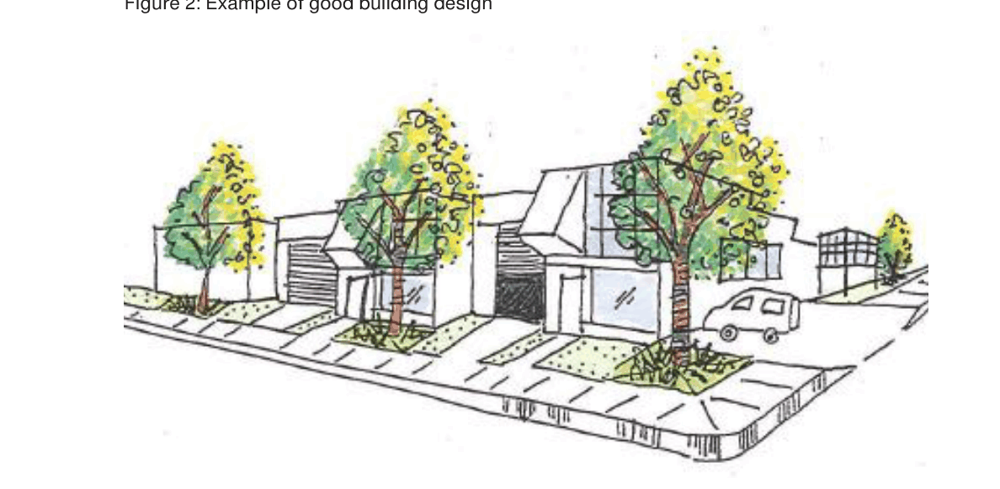

## 3. Building design

Explanation Good building design and appearance can ensure a high level of amenity and enhance the attractiveness of the streetscape. Through high aesthetic standards, industrial buildings can be designed to provide and maintain a suitable level of visual, acoustic and environmental quality.

Objectives The objectives for building design are to:

1\. Ensure the form and scale of development enhances the streetscape and visual quality of the area

2\. Achieve high quality, innovative and sustainable design for industrial buildings

3\. Utilise materials and construction methods to mitigate noise and visual impact to adjoining areas, particularly residential areas.

Controls

a) Building mass and scale should make a positive contribution to the streetscape and compliment the predominant character of the adjoining area

b) Building form is to provide visual interest through an articulated façade, such as

i. projecting wall elements, shading devices and a variation in texture / finishes / materials

ii. Building entries should be clear with windows facing the street

c) Avoid bulky roof forms or extensive blank facades in a single material or colour, particularly when visible from the public domain

d) Roof design must be incorporated in the overall building design

e) Any metal roof sheeting should be pre-painted (e.g. Colourbond) to limit the level of reflection and glare

f) Building entrances should be clearly defined, well-articulated a through form, materials and colour

g) Provide level or ramp access to entrances and waiting areas

h) Visible light reflectivity from building materials used on the facades of new buildings should not exceed 20%. The use of non-reflective glass should also be considered

i) To promote casual surveillance, office components of an industrial development should be located at the front of the property with windows and entrances facing the street, with the warehousing or industrial use set behind

j) Buildings should maximise energy efficiency, through measures such as the use of high efficiency lighting systems, insulation, natural ventilation and lighting, and low embodied energy materials (see ecologically sustainable development (ESD) requirements in Part

B4 of this DCP)

k) Open storage areas shall not be visible from any public place and be clearly defined on plan in the development application.

> [Picture on page 11: a picture, saved as a picture (images/part-c10-industrial-areas-page-11-3.gif, 150 dpi).]

Figure 2: Example of good building design

Sources: Randwick City Council 2022
