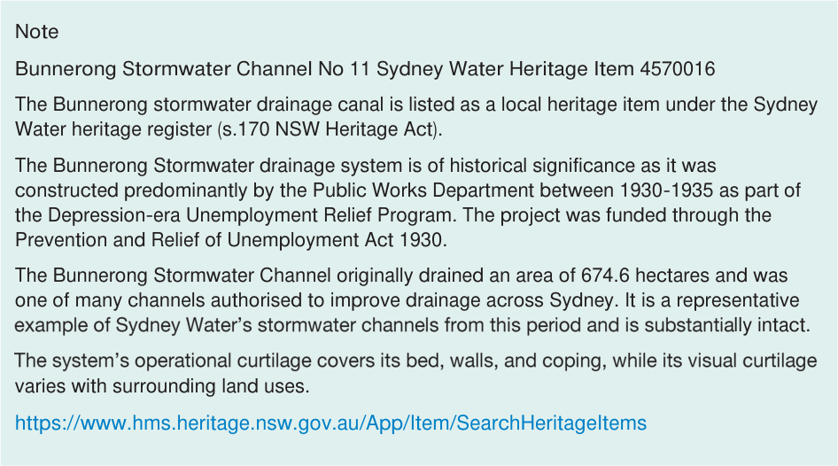

## 4. Setbacks

Explanation This section applies to new buildings only. Building setbacks play an important role in industrial zones by establishing a consistent streetscape, providing space for landscaping, and reducing the visual bulk and scale of development. Front setbacks contribute to the overall character, reinforce the public domain and presentation of industrial streets, ensures space for landscaping, contributes to streetscape consistency, and mitigates the bulk and scale of industrial development. Side Setbacks also provide separation and a transitional area and act as a buffer to adjoining land uses, particularly where sensitive interfaces occur.

Objectives The objectives for setbacks are to:

1\. Minimise the adverse impacts of industrial development on adjoining land uses including noise, air quality and odour by providing building separation and buffering

2\. Ensure development that responds to and reinforces the streetscape character and ensures a positive well-presented and functional streetscape environment.

Controls

a) The front setback of an industrial building must respond to the dominant street setback. Where there is no clear dominant setback or for sites with large frontages, the front setbacks will be determined on merit, having regard to the desired streetscape character and function

b) Front setbacks must be landscaped to provide a high-quality streetscape. Front setbacks must not to be used for storage or display of goods, excessive signage, loading/unloading areas and large areas of car parking

c) Where the development adjoins non-industrial uses, a minimum side and/or rear setback of 5m must be provided to provide adequate separation and buffering to

d) In all other cases, a minimum side and rear setback of 4m is required

e) No buildings, structures, car parking, storage or vehicle manoeuvring areas are permitted within a minimum 6m wide setback area adjoining the Sydney Water heritage listed Bunnerong canal

f) Setbacks must be designed to maximise the retention and protection of existing trees and their root systems.  Variations to setback dimensions may be considered where this would result in improved tree retention outcomes Landscaping setbacks must be free from overhangs, hardstand elements such as ramps and driveways and paved areas, except where minor pedestrian access paths are required.

The minimum setback requirements are summarised in the table below:

| Boundary | Landscape Setback (minimum) | Building Setback (minimum) 9 metres 9 metres 5 metres metres metres |
|---|---|---|
| Frontage to a classified road | 4 metres |  |
| Frontage to a local road | 3 metres |  |
| Side boundary - residential use | 5 metres |  |
| Side boundary - non-residential use | 4 metres 4 |  |
| Rear boundary – residential use | 5 metres 5 |  |
| Rear boundary - any other use | 4 metres 4 metres |  |
| Canal boundary | 6 metres 10 metres |  |

> [Picture on page 13: a picture, saved as a picture (images/part-c10-industrial-areas-page-13-2.gif, 150 dpi).]
> Words printed on the picture (title and legend, copied from the PDF):
> example of Sydney Water’s stormwater channels from this period and is substantia lly intact.
> The system’s operational curtilage covers its bed, walls, and coping, while its visual curtilage

Note Bunnerong Stormwater Channel No 11 Sydney Water Heritage Item 4570016 The Bunnerong stormwater drainage canal is listed as a local heritage item under the Sydney Water heritage register (s.170 NSW Heritage Act). The Bunnerong Stormwater drainage system is of historical significance as it was constructed predominantly by the Public Works Department between 1930-1935 as part of the Depression-era Unemployment Relief Program. The project was funded through the Prevention and Relief of Unemployment Act 1930. The Bunnerong Stormwater Channel originally drained an area of 674.6 hectares and was one of many channels authorised to improve drainage across Sydney. It is a representative

varies with surrounding land uses. https://www.hms.heritage.nsw.gov.au/App/Item/SearchHeritageItems

Note: Setbacks are to be in accordance with TfNSW requirements in relation to classified roads and signalised intersections.
