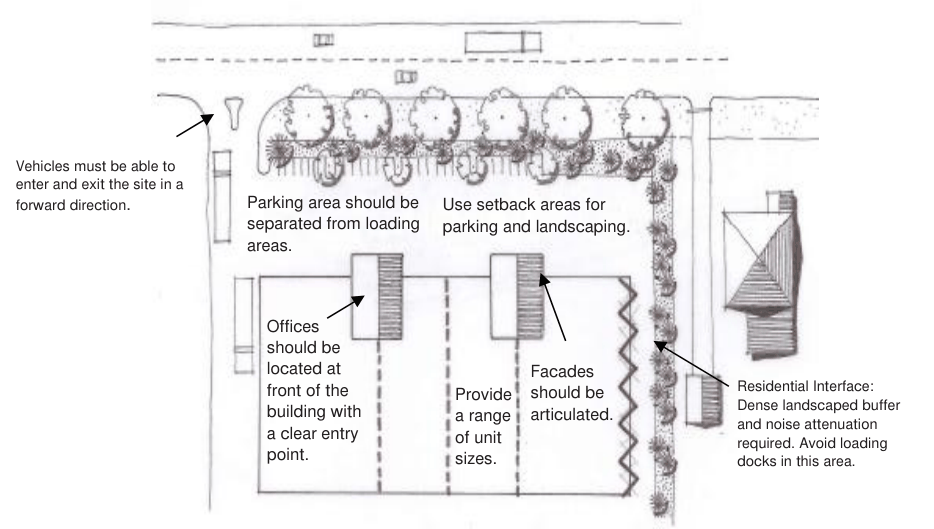

## 5. Landscaping

Explanation Well designed landscaped areas can enhance the visual quality and environmental performance of a development contributing to an attractive and sustainable industrial environment. Landscaping improves the amenity of workplaces for employees and visitors and plays an important role in defining the character of industrial areas. Landscaping also provides effective buffering between industrial development and surrounding land uses and assists in screening and softening the visual impact of industrial buildings, structures and signage particularly where large-scale built form is involved (see Figure 3 below).

Objectives The objectives for landscaping are to:

1\. Improve the environmental and visual amenity of industrial areas

2\. Integrate building design, car parking and service facilities with landscaping

3\. Ensure the provision of accessible and useable open space for the use of employees

4\. Encourage the planting of indigenous, native and low water consuming plants and trees

5\. Assist stormwater management by maximising permeable areas.

Controls

a) A minimum of 10% of the development site must be provided as landscaped area

b) Landscaping must be planned and designed to improve the environmental and visual amenity of industrial areas including the provision of shade, screening, and urban greening

c) Building design, car parking and service facilities must be integrated with landscaping

d) Ensure the provision of accessible and useable open space for the use of employees

e) For sites in excess of 1,000m², an outdoor staff recreation area must be provided with a minimum area of 16m², with a minimum dimension of 3 metres in any direction

f) A minimum of 60% of the plantings must comprise indigenous native species as specified in Appendix B4, complemented by drought-tolerant and low water-use plantings

g) To assist stormwater management development must comprise hard stand and non-porous surfaces must be minimised Development must incorporate permeable paving, deep soil zones, and other water-sensitive urban design (WSUD) measures to assist stormwater infiltration, reduce runoff, and improve water quality.

Figure 3: Landscaping design

> [Picture on page 15: a map, saved as a picture (images/part-c10-industrial-areas-page-15-2.gif, 150 dpi); the street names and other small labels are on the picture.]
> Words printed on the picture (title and legend, copied from the PDF):
> Vehicles must be able to
> enter and exit the site in a
> Use setback areas for
> parking and landscaping.
> Parking area should be
> separated from loading
> front of the
> a clear entry
> Dense landscaped buffer
> and noise attenuation
> required. Avoid loading
> docks in this area.

Source: Randwick City Council 2022
